# **Project Report Collaboration Insights**

## **AV2:**

### **1. Project Report Repository (`children-path-report`)**
* **URL del Repositorio:** [https://github.com/upc-202620-lasi0730-8084-Creatividad/children-path-report](https://github.com/upc-202620-1asi0730-8084-Creatividad/children-path-report/tree/develop)

* **Reporte de Commits:**
  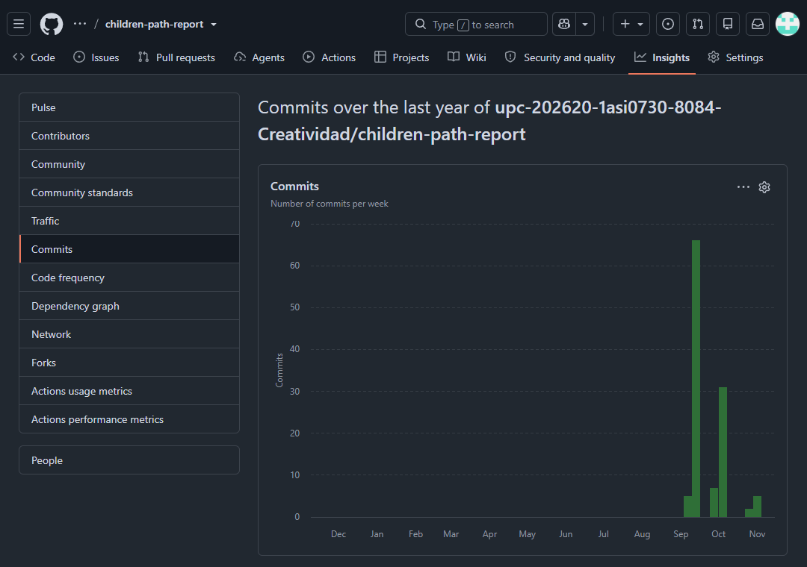

* **Reporte de Contribuidores:**
  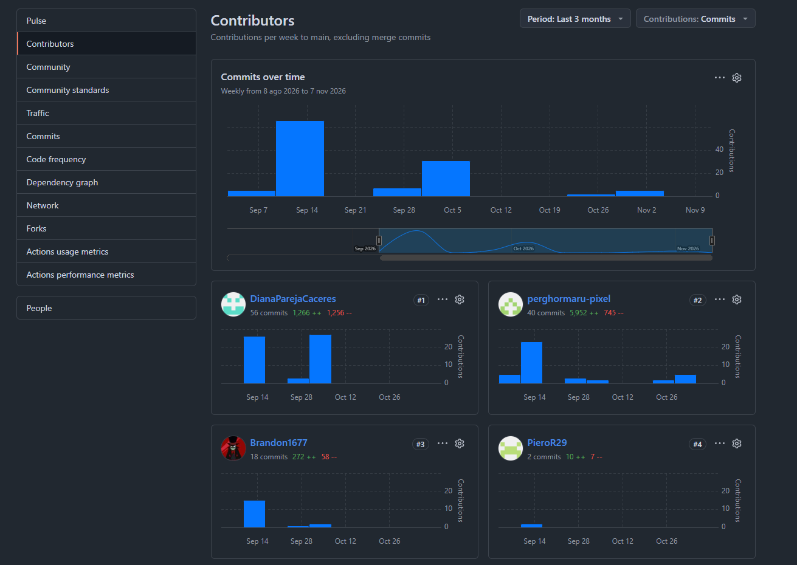

* **Reporte de Red (Network Graph):**
  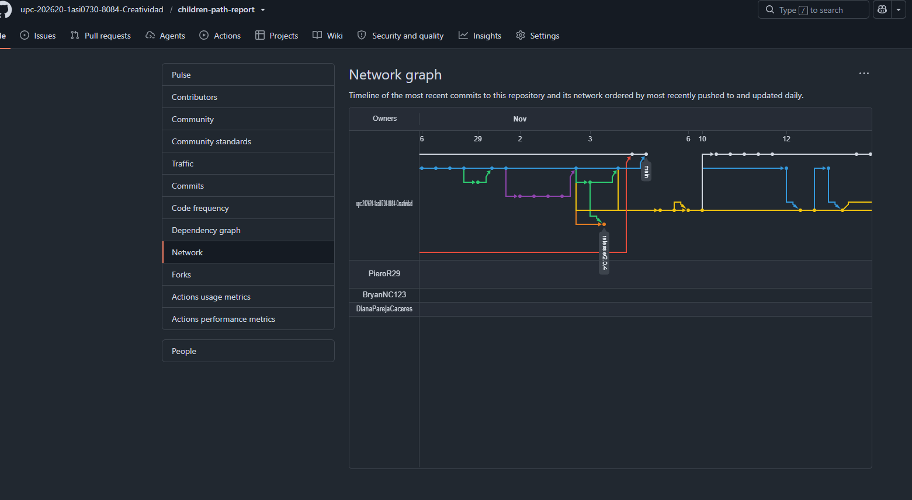

---

### **2. Website / Landing Page Repository (`children-path-website`)**
* **URL del Repositorio:** [https://github.com/upc-202620-1asi0730-8084-Creatividad/children-path-website](https://github.com/upc-202620-1asi0730-8084-Creatividad/children-path-website)

* **Reporte de Commits:**
  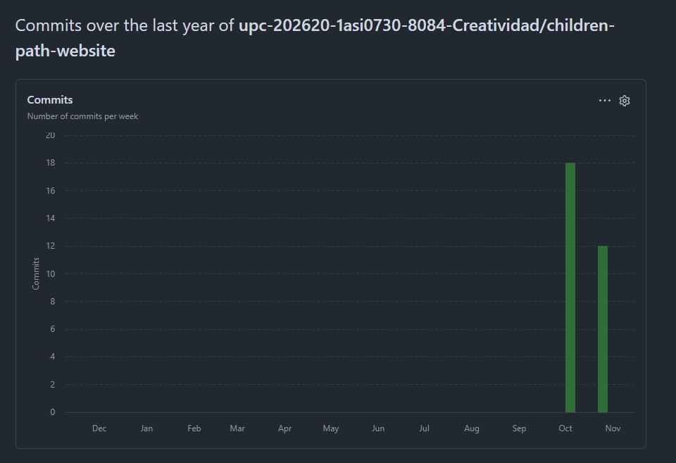

* **Reporte de Contribuidores:**
  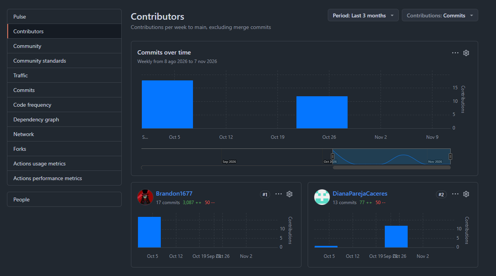

* **Reporte de Red (Network Graph):**
  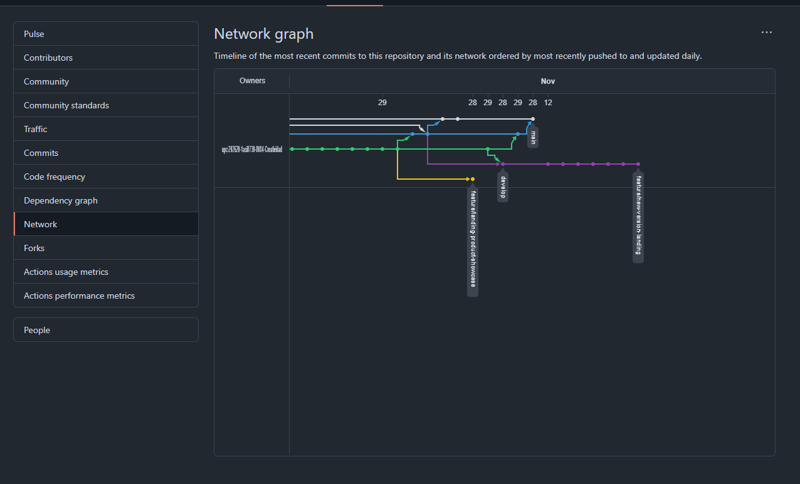

---

### **3. Web Application Repository (`children-path-web-application`)**
* **URL del Repositorio:** [https://github.com/upc-202620-1asi0730-8084-Creatividad/children-path-web-application/tree/develop](https://github.com/upc-202620-1asi0730-8084-Creatividad/children-path-web-application/tree/develop)

* **Reporte de Commits:**
  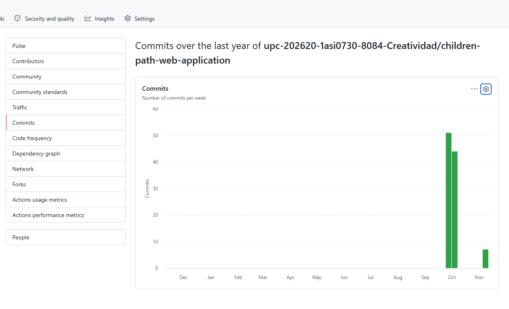

* **Reporte de Contribuidores:**
  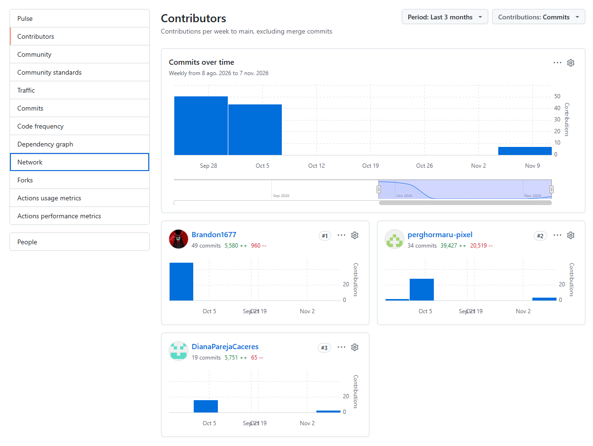

* **Reporte de Red (Network Graph):**
  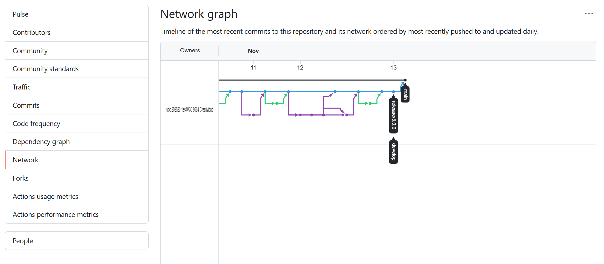

---

### **4. Backend Repository (`children-path-backend`)**
* **URL del Repositorio:** [https://github.com/upc-202620-1asi0730-8084-Creatividad/children-path-backend/tree/develop](https://github.com/upc-202620-1asi0730-8084-Creatividad/children-path-backend/tree/develop)

* **Reporte de Commits:**
  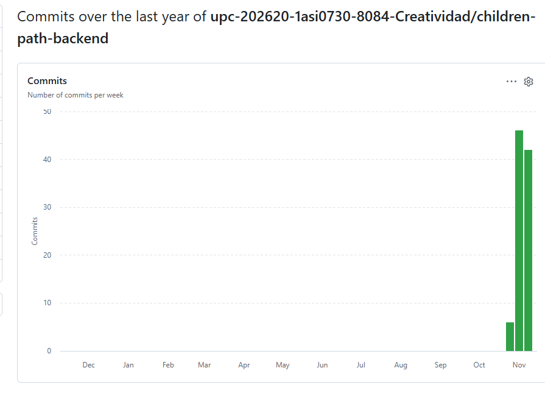

* **Reporte de Contribuidores:**
  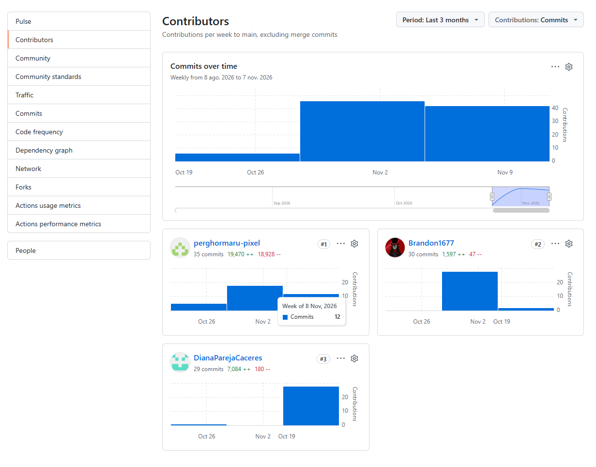

* **Reporte de Red (Network Graph):**
  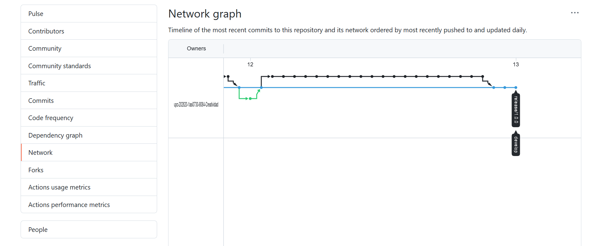
