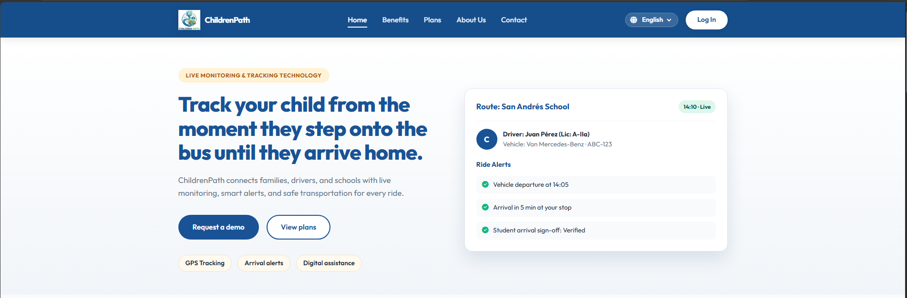
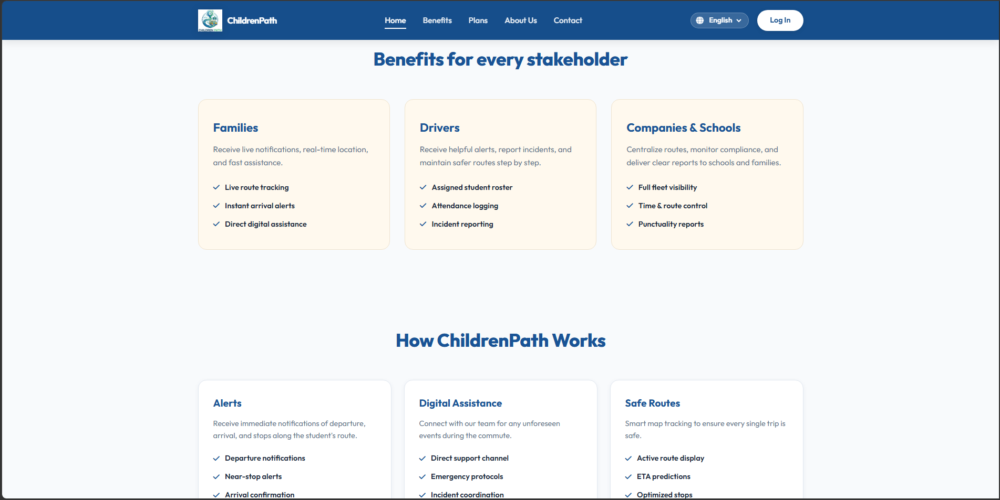
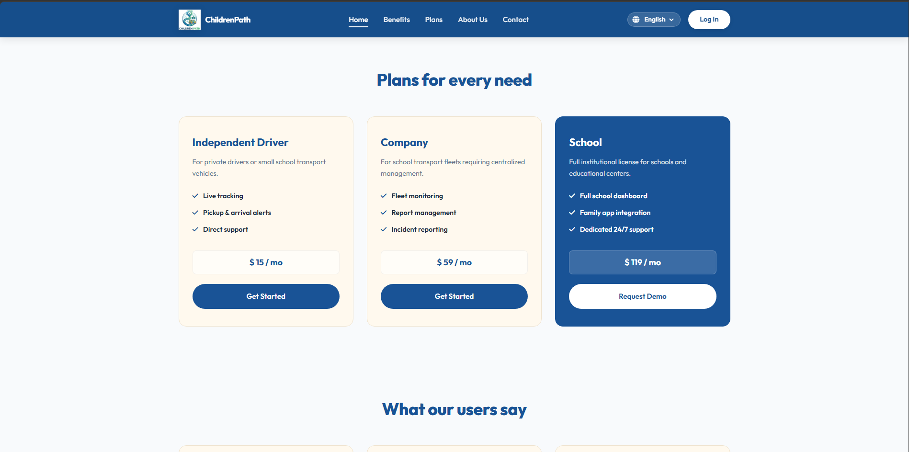
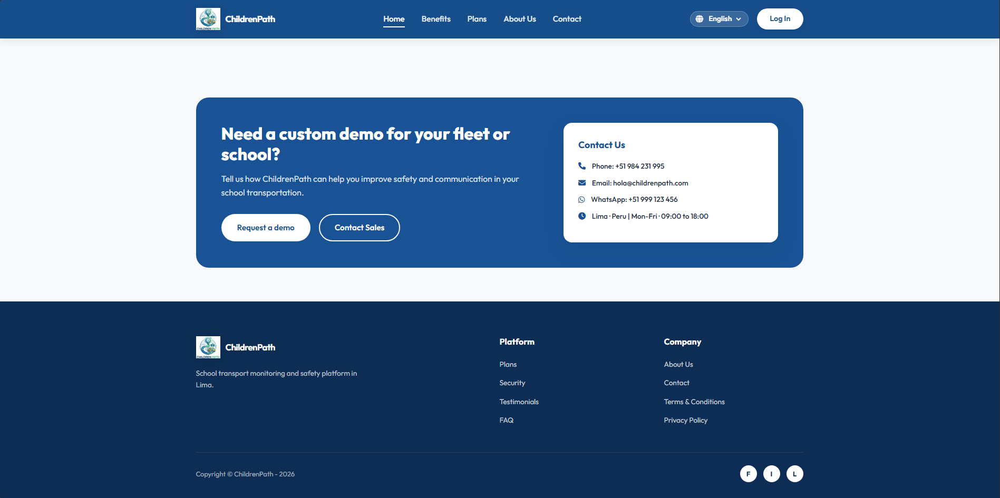
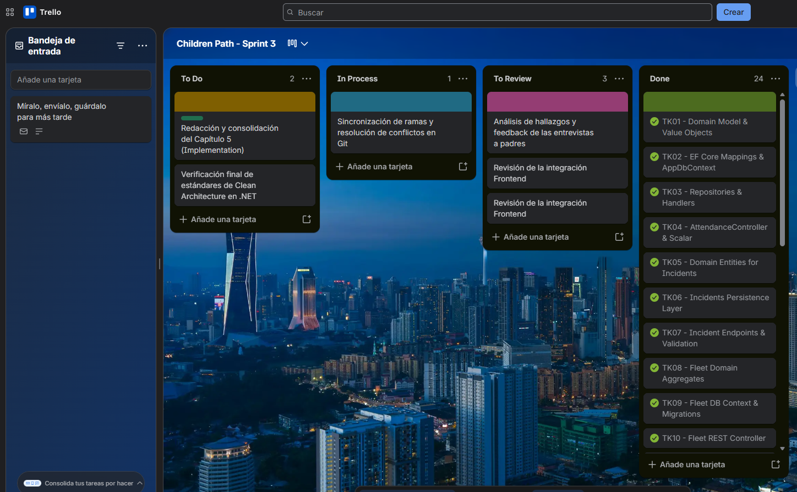

# **Capítulo V: Implementación, Validación y Despliegue del Producto**

## **5.1. Gestión de la Configuración del Software**

Esta sección describe las herramientas, configuraciones y convenciones adoptadas por el equipo para garantizar la consistencia, calidad y trazabilidad a lo largo del ciclo de vida del producto **Children Path**.

La implementación de prácticas de gestión de la configuración permitió una colaboración efectiva, un control de versiones adecuado y un proceso de desarrollo estructurado, asegurando que todos los componentes de la solución estuvieran alineados y fueran mantenibles.

### **5.1.1. Configuración del Entorno de Desarrollo de Software**

Para apoyar el desarrollo del proyecto, el equipo utilizó un conjunto de herramientas que cubren todas las etapas del ciclo de vida del software:

- **GitHub:** utilizado como plataforma principal para el control de versiones y la colaboración del equipo.
- **Visual Studio Code:** entorno de desarrollo principal para la landing page.
- **Figma:** utilizado para el diseño UI/UX y la creación de prototipos.
- **Structurizer:** utilizado para el modelado C4.
- **Miro:** utilizado para la creación de diagramas de flujo y mapas conceptuales.
- **UXXPRESSIA** utilizado para la creación de mapas de experiencia del usuario y customer journey maps.

Estas herramientas permitieron una integración eficiente entre los procesos de diseño, desarrollo, pruebas y validación.

### **5.1.2. Gestión del Código Fuente**

El proyecto utiliza **GitHub** como sistema de control de versiones. Se crearon repositorios separados para cada componente principal de la solución:

- **children-path-landing-page:** Repositorio dedicado al sitio de presentación estática (Landing Page).

    [Link del repositorio children-path-landing-page](https://github.com/upc-202610-1asi0730-8084-Creatividad/children-path-landing-page)

 - **children-path-frontend** Espacio reservado para el código del cliente web (Frontend) construido en Vue.js.

    [Link del repositorio children-path-frontend](https://github.com/upc-202610-1asi0730-8084-Creatividad/children-path-frontend)

 - **children-path-report:** Repositorio de soporte utilizado para la gestión de la documentación técnica y los informes del proyecto.
  
    [Link del repositorio children-path-report](https://github.com/upc-202610-1asi0730-8084-Creatividad/children-path-report)

El equipo adoptó el modelo de ramificación **GitFlow** para gestionar el desarrollo de manera eficiente:

- **main:** contiene la versión estable de producción.
- **develop:** integra el trabajo de desarrollo en curso.
- **feature/*:** ramas para nuevas funcionalidades.

Convenciones de nomenclatura:

- `feature/add-section-1-1`
- `feature/add-chapter-3`
- `release/v0.1.0`
- `fix/remodalate-impact-mapping`
- `hotfix/cover-fix`

Además, el equipo aplicó **Versionado Semántico (SemVer)**:

- `v1.0.0` → versión estable inicial
- `v0.1.0` → nuevas funcionalidades agregadas
- `v0.1.1` → corrección de errores

Los mensajes de commit siguen el estándar **Conventional Commits**. Este enfoque garantiza un historial de desarrollo claro y trazable.

### **5.1.3. Guía de Estilo y Convenciones de Código Fuente**

Para garantizar la calidad y mantenibilidad del código, el equipo adoptó convenciones estándar de codificación:

- Todos los elementos del código (variables, funciones, clases) se escriben en inglés.
- **camelCase** para variables y funciones.
- Estructura de código modular para una mejor organización.

**Convenciones aplicadas por lenguaje:**

**HTML**

Siguiendo la "HTML Style Guide and Coding Conventions" de W3Schools y la "Google HTML/CSS Style Guide", se mantiene una arquitectura semántica y accesible. El código se escribe íntegramente en minúsculas, con una indentación de dos espacios y comentarios descriptivos para separar bloques funcionales.

**Estructura y etiquetas principales empleadas:**

- **Base:** `<!DOCTYPE html>`, `<html>`, `<head>`, `<body>` para la jerarquía global.
- **Metadatos:** `<meta>`, `<title>`, `<link>` para la configuración y vinculación de estilos.
- **Semántica:** `<nav>`, `<section>`, `<header>`, `<footer>`, `<main>` para la organización del contenido principal.
- **Contenido:** `<h1>`, `<h2>`, `
`, ``, `<a>` para la visualización de métricas y enlaces.
- **Interacción:** `<form>`, `<input>`, `<label>`, `<button>` para el registro de datos en formularios interactivos.

**CSS**

El archivo styles.css se estructuró bajo la "Google HTML/CSS Style Guide", aplicando una organización modular mediante comentarios (ej. /* NAVIGATION */, /* HERO CAROUSEL */). Se emplea kebab-case para clases y una indentación uniforme.

**Propiedades y convenciones aplicadas:**

- **Diseño y Layout:** `display: flex`, `grid-template-columns`, `position`, `z-index` para una interfaz responsiva.
- **Dimensiones:** `width`, `height`, `max-width`, `min-height`.
- **Espaciado:** `padding`, `margin`, `gap`.
- **Tipografía:** `font-family`, `font-size`, `font-weight`, `line-height`, `color`.
- **Decoración:** `background-color`, `border-radius`, `box-shadow`, `border`.
- **Interactividad:** `transition`, `transform`, `:hover` para mejorar la experiencia de usuario.

**JavaScript**

La lógica de cliente se fundamenta en las "MDN JavaScript guidelines" y la "W3C JavaScript Style Guide", priorizando un código modular, seguro y de alto rendimiento. Se emplea tanto en el desarrollo del Landing Page para la interactividad del sitio estático, como en la Web Application como base del framework Vue.js. Se aplica la convención camelCase para la nomenclatura de variables y funciones, y se utilizan comentarios descriptivos en inglés para documentar la finalidad de cada bloque funcional.

**Estructura y elementos técnicos aplicados:**

- **Selección del DOM:** Uso de métodos estandarizados como `document.getElementById()` y `document.querySelector()` para la captura de elementos de la interfaz.
- **Gestión de Eventos:** Implementación de `addEventListener()` para controlar acciones como click (botones de registro), submit (formularios de métricas) y el evento `DOMContentLoaded` para asegurar la carga del script.
- **Validaciones de Datos:** Aplicación de expresiones regulares para verificar la integridad de correos electrónicos, teléfonos y formatos de entrada.
- **Interacción Dinámica:** Manipulación de clases mediante `classList` para menús interactivos, modales de confirmación y feedback visual en formularios.
- **Control Lógico:** Empleo de condicionales `(if/else)`, bucles de iteración `(forEach)` y temporizadores `(setInterval())` para la actualización de datos en tiempo real.

Las Historias de Usuario y los Criterios de Aceptación se redactaron utilizando un formato estructurado basado en **Gherkin** para mejorar la claridad y legibilidad.

### **5.1.4. Configuración de Despliegue del Software**

El proceso de despliegue para cada componente del sistema se define de la siguiente manera:

**Landing Page**
- Abrir el archivo HTML principal o desplegarlo en un servicio de hosting.
- Validar la capacidad responsive en diferentes dispositivos.

Esta configuración permite que cualquier miembro del equipo ejecute y despliegue el sistema de forma consistente.

## **5.2. Implementación de la Landing Page, Servicios y Aplicaciones**

### **5.2.1. Sprint 1**

#### **5.2.1.1. Sprint Planning 1**

Durante el Sprint 1, el equipo planificó, diseñó, implementó y desplegó el sitio web estático público (Landing Page) de **Children Path**. El objetivo primordial consistió en materializar la presencia digital de la plataforma mediante un portal web responsive y estructurado que comunicara la propuesta de valor, los beneficios diferenciados por actor clave, los módulos de seguridad vehicular, testimonios de validación social y canales interactivos de contacto directo.

| Sprint # | Sprint 1 |
| :--- | :--- |
| **Sprint Planning Background** | Implementación, maquetación responsive y despliegue continuo de la Landing Page |
| **Date** | 2026-09-06 |
| **Time** | 07:00 PM |
| **Location** | Reunión virtual vía Google Meet |
| **Prepared By** | Huaco Oliva, Luis Alonso |
| **Attendees (to planning meeting)** | Huaco Oliva, Luis Alonso / Pareja Cáceres, Diana / Soto, Brandon / Rázuri, Piero |
| **Sprint n – 1 Review Summary** | No aplica. Sprint inicial del ciclo del producto. |
| **Sprint n – 1 Retrospective Summary** | No aplica. Sprint inicial del ciclo del producto. |
**Sprint Goal & User Stories**

| Sprint Goal | Description |
| ------------------- | ---------------------------------------------------------------------------------------------------------------------------------------------------------------------------------------------------------------------------------------------------- |
| **Sprint 1 Goal** | Nuestro enfoque está en diseñar una Landing Page clara y estructurada. Creemos que esto permitirá que los usuarios potenciales comprendan el valor del producto. Esto se confirmará cuando los usuarios puedan identificar el problema y la solución en la primera interacción. |
| **Sprint 1 Velocity** | 14 Story Points |
| **Sum of Story Points** | 14 Story Points |

#### **5.2.1.2. Aspect Leaders and Collaborators**

Durante este Sprint, el equipo trabajó en el diseño de la Landing Page, la estructura UX y la creación de contenido.

| Team Member | GitHub Username | UI/UX Wireframing & Design | HTML/CSS Component Layout | JavaScript Interactivity (FAQ & CTA) | Deployment & Cross-Browser QA |
| :--- | :--- | :---: | :---: | :---: | :---: |
| Huaco, Luis | perghormaru-pixel | L | C | L | C |
| Pareja, Diana | DianaParejaCaceres | C | L | C | L |
| Soto, Brandon | Brandon1677 | C | C | L | C |
| Rázuri, Piero | piero-razuri | L | C | C | C |

**Leyenda:** L = Leader (Líder) | C = Collaborator (Colaborador)

#### **5.2.1.3. Sprint Backlog 1**

El Sprint Backlog se enfocó en definir la estructura y el diseño inicial de la Landing Page.

<table width="100%">
  <thead>
    <tr>
      <th colspan="2" style="text-align:center">User Story</th>
      <th colspan="6" style="text-align:center">Work-Item / Task</th>
    </tr>
    <tr>
      <th style="width: 8%; text-align:center">Story Id</th>
      <th style="width: 20%; text-align:center">Story Title</th>
      <th style="width: 9%; text-align:center">Task Id</th>
      <th style="width: 20%; text-align:center">Task Title</th>
      <th style="width: 25%; text-align:center">Task Description</th>
      <th style="width: 6%; text-align:center">Estimation (Hours)</th>
      <th style="width: 12%; text-align:center">Assigned To</th>
      <th style="width: 8%; text-align:center">Status</th>
    </tr>
  </thead>
  <tbody>
    <!-- US59 -->
    <tr>
      <td rowspan="2" align="center" style="font-weight:bold; vertical-align:middle">US59</td>
      <td rowspan="2" style="vertical-align:middle">Visualizar Hero section, métricas y pitch principal</td>
      <td align="center">TS1-01</td>
      <td>Diseño UI y Maquetación de Navbar, Hero y Métricas</td>
      <td>Diseñar y codificar el encabezado institucional, banner con simulación de ruta en vivo y la barra de métricas (Trust in every journey).</td>
      <td align="center">7</td>
      <td>Diana Pareja</td>
      <td align="center">Done</td>
    </tr>
    <tr>
      <td align="center">TS1-02</td>
      <td>Implementación de Botones CTA y Redirección Login</td>
      <td>Configurar botones "Request a demo", "View plans" y enlace de acceso al aplicativo en JavaScript.</td>
      <td align="center">5</td>
      <td>Brandon Soto</td>
      <td align="center">Done</td>
    </tr>
    <!-- US60 -->
    <tr>
      <td rowspan="2" align="center" style="font-weight:bold; vertical-align:middle">US60</td>
      <td rowspan="2" style="vertical-align:middle">Explorar beneficios segmentados por rol de usuario</td>
      <td align="center">TS1-03</td>
      <td>Maquetación de Tarjetas de Beneficios por Stakeholder</td>
      <td>Estructurar la cuadrícula CSS para las tres tarjetas diferenciadas: Families, Drivers y Companies & Schools con listas de verificación.</td>
      <td align="center">6</td>
      <td>Luis Huaco</td>
      <td align="center">Done</td>
    </tr>
    <tr>
      <td align="center">TS1-04</td>
      <td>Adaptabilidad Responsive de Beneficios (Mobile/Tablet)</td>
      <td>Configurar Media Queries para colapsar las tres columnas en layout apilado fluido en resoluciones de 360px a 768px.</td>
      <td align="center">5</td>
      <td>Diana Pareja</td>
      <td align="center">Done</td>
    </tr>
    <!-- US61 -->
    <tr>
      <td rowspan="2" align="center" style="font-weight:bold; vertical-align:middle">US61</td>
      <td rowspan="2" style="vertical-align:middle">Consultar módulos de funcionamiento y seguridad de la plataforma</td>
      <td align="center">TS1-05</td>
      <td>Maquetación de la Sección "How ChildrenPath Works"</td>
      <td>Codificar el contenedor de 6 tarjetas: Alerts, Digital Assistance, Safe Routes, Fleet Monitoring, Integration y Privacy.</td>
      <td align="center">6</td>
      <td>Piero Rázuri</td>
      <td align="center">Done</td>
    </tr>
    <tr>
      <td align="center">TS1-06</td>
      <td>Optimización de Iconografía SVG y Tipografía</td>
      <td>Estandarizar iconos vectoriales, paleta de colores corporativos y pesos de fuente para garantizar contraste accesible.</td>
      <td align="center">4</td>
      <td>Diana Pareja</td>
      <td align="center">Done</td>
    </tr>
    <!-- US62 -->
    <tr>
      <td rowspan="2" align="center" style="font-weight:bold; vertical-align:middle">US62</td>
      <td rowspan="2" style="vertical-align:middle">Consultar planes de suscripción y tarifas comerciales</td>
      <td align="center">TS1-07</td>
      <td>Maquetación de la Tarjeta Comparativa de Planes</td>
      <td>Codificar las tarjetas de precios para Independent Driver, Company y School destacando el plan institucional.</td>
      <td align="center">6</td>
      <td>Brandon Soto</td>
      <td align="center">Done</td>
    </tr>
    <tr>
      <td align="center">TS1-08</td>
      <td>Configuración de Enlaces y Smooth Scrolling a Contacto</td>
      <td>Vincular botones de contratación y solicitud de demo hacia el formulario de contacto mediante desplazamiento suave.</td>
      <td align="center">4</td>
      <td>Luis Huaco</td>
      <td align="center">Done</td>
    </tr>
    <!-- US63 -->
    <tr>
      <td rowspan="2" align="center" style="font-weight:bold; vertical-align:middle">US63</td>
      <td rowspan="2" style="vertical-align:middle">Revisar testimonios reales y preguntas frecuentes (FAQ)</td>
      <td align="center">TS1-09</td>
      <td>Maquetación de Testimonios (Social Proof)</td>
      <td>Crear tarjetas con citas y perfiles de apoderados, conductores y directivos de centros educativos en Lima.</td>
      <td align="center">5</td>
      <td>Piero Rázuri</td>
      <td align="center">Done</td>
    </tr>
    <tr>
      <td align="center">TS1-10</td>
      <td>Lógica de Acordeón Interactivo para FAQ en JS</td>
      <td>Programar interactividad de apertura y cierre animado de preguntas frecuentes sobre cobertura, flotas y soporte.</td>
      <td align="center">6</td>
      <td>Brandon Soto</td>
      <td align="center">Done</td>
    </tr>
    <!-- US64 -->
    <tr>
      <td rowspan="2" align="center" style="font-weight:bold; vertical-align:middle">US64</td>
      <td rowspan="2" style="vertical-align:middle">Solicitar demostración comercial y acceder a canales de contacto</td>
      <td align="center">TS1-11</td>
      <td>Maquetación de Bloque de Contacto y Canales Directos</td>
      <td>Codificar tarjeta de contacto con teléfono, correo hola@childrenpath.com, WhatsApp oficial y horario de atención.</td>
      <td align="center">5</td>
      <td>Luis Huaco</td>
      <td align="center">Done</td>
    </tr>
    <tr>
      <td align="center">TS1-12</td>
      <td>Implementación de Footer, Redes y Despliegue en GitHub Pages</td>
      <td>Estructurar pie de página con enlaces legales, redes sociales y configurar pipeline de publicación en GitHub Pages.</td>
      <td align="center">5</td>
      <td>Brandon Soto</td>
      <td align="center">Done</td>
    </tr>
  </tbody>
</table>

#### **5.2.1.4. Development Evidence for Sprint Review**

Durante este Sprint, el equipo completó el diseño conceptual de la Landing Page.

| Repository | Branch | Commit Id | Commit Message | Commit Message Body | Commited on (Date) |
| :--- | :--- | :---: | :--- | :--- | :---: |
| children-path-landing-page | `main` | `3cc3693` | Merge pull request #6 from upc-2.../develop | Synced accessibility styles and responsive improvements into production branch. | 2026-10-05 |
| children-path-landing-page | `develop` | `c84b74b` | Merge pull request #5 from .../feature/accessibility-styling | Integrated WCAG accessibility layers and typographic optimizations into develop. | 2026-10-05 |
| children-path-landing-page | `feature/accessibility-styling` | `6e06ef3` | style: enhance accessibility focus states and typographic rendering | Added WCAG focus-visible indicators, cross-browser font smoothing, and prefers-reduced-motion media query in styles.css. | 2026-10-05 |
| children-path-landing-page | `main` | `d17ed10` | Merge pull request #4 from upc-2.../develop | Merged brand logo style corrections and asset link updates into main. | 2026-10-05 |
| children-path-landing-page | `develop` | `1c024bd` | Feat: add new brand logo and style | Consolidated core branding updates, visual style guides, and typography definitions across views. | 2026-10-05 |
| children-path-landing-page | `feature/views-markup` | `3eb7039` | Fix: brand logo problems fixed | Resolved SVG logo path references and dimensions across all HTML view templates. | 2026-10-05 |
| children-path-landing-page | `main` | `02fb93f` | Merge pull request #3 from upc-2.../develop | Merged auth redirection script and About section content fixes. | 2026-10-05 |
| children-path-landing-page | `feature/auth-redirect` | `f23619e` | Feat: add the redirect link of login | Added JavaScript event listeners linking header CTA buttons to the web application sign-in entry point. | 2026-10-05 |
| children-path-landing-page | `feature/views-markup` | `986be3a` | Fix: Changes on about us section | Updated mission, vision, and team card descriptions in about.html. | 2026-10-05 |
| children-path-landing-page | `main` | `db7be07` | Merge pull request #2 from upc-2.../develop | Merged asset integration and internationalization dictionary updates. | 2026-10-05 |
| children-path-landing-page | `develop` | `8d1befd` | Feat: add landing page imagery assets | Imported optimized vector icons and graphic banners for stakeholder and hero sections. | 2026-10-05 |
| children-path-landing-page | `feature/i18n` | `fe4cf99` | Feat: Update i18n.js | Configured internationalization language dictionary and dynamic string binding logic. | 2026-10-05 |
| children-path-landing-page | `feature/styles` | `22a2f66` | Feat: Update styles.css content | Configured base typography, color variables, layout grids, and card styling. | 2026-10-05 |
| children-path-landing-page | `feature/views-markup` | `5cbfa23` | Feat: add terms.html file content | Implemented markup and legal policy containers in terms.html. | 2026-10-05 |
| children-path-landing-page | `feature/views-markup` | `cacc083` | Feat: add contact.html file content | Maquetted contact form container and commercial communication channels in contact.html. | 2026-10-05 |
| children-path-landing-page | `feature/views-markup` | `64bde1f` | Feat: add about.html file content | Added structured sections for company vision, benefits, and team cards in about.html. | 2026-10-05 |
| children-path-landing-page | `feature/views-markup` | `65bb15e` | Feat: add index.html file content | Structured primary layout, hero section, stakeholder benefits, and pricing cards in index.html. | 2026-10-05 |
| children-path-landing-page | `feature/scripts` | `3577fd3` | Feat: add main interactive JS for UI behaviors | Programmed FAQ collapsible accordion and smooth scrolling behavior for action buttons. | 2026-10-05 |
| children-path-landing-page | `develop` | `923fcab` | Chore: Initial commits | Initialized Git repository structure and root directories. | 2026-10-05 |

#### **5.2.1.5. Execution Evidence for Sprint Review**

Durante este Sprint, el equipo validó la estructura y claridad de la Landing Page.

| Evidence Type | Description |
| --------------- | -------------------------------------------------------------------------------------------------- |
| Wireframes | Diseño de baja fidelidad que muestra el layout |
| UX validation | Flujo lógico entre secciones |
| Internal review | Retroalimentación de los miembros del equipo |

##### Vistas y Secciones Implementadas:

* **Figura 5.1:** *Hero Section, Simulación de Ruta y Métricas de Confianza (`index.html`).*  
  Encabezado principal con propuesta de valor, navegación institucional, llamado a la acción para solicitud de demostración y widget interactivo de monitoreo de ruta en vivo.  
  

* **Figura 5.2:** *Beneficios Segmentados para Stakeholders y Módulos de Operación ("How ChildrenPath Works").*  
  Cuadrícula con listas de verificación para Familias, Conductores y Cosprint 3legios, complementada con los módulos de alertas inmediatas, asistencia digital y trazabilidad segura.  
  

* **Figura 5.3:** *Planes de Suscripción Comerciales y Preguntas Frecuentes (FAQ).*  
  Estructura tarifaria comercial diferenciada para Independent Driver, Company y School, junto con el acordeón interactivo de dudas frecuentes implementado en JavaScript.  
  

* **Figura 5.4:** *Canales de Contacto Directo ("Contact Us") y Pie de Página Institucional.*  
  Tarjeta de contacto con teléfono corporativo, correo de soporte, canal oficial de WhatsApp y pie de página con navegación legal y enlaces institucionales.  
  

#### **5.2.1.6. Services Documentation Evidence for Sprint Review**

| Status |
| ------------------------------------------------------------------------ |
| No aplica. No se implementaron servicios RESTful durante este Sprint. |

#### **5.2.1.7. Software Deployment Evidence for Sprint Review**

A continuación, se detalla la evidencia del despliegue en producción del sitio web público de captación:

| Plataforma de Despliegue | Entorno | URL Pública del Despliegue | Evidencia de Operación |
| :--- | :---: | :--- | :--- |
| GitHub Pages | Producción | [https://upc-202610-1asi0730-8084-creatividad.github.io/children-path-landing-page/](https://upc-202610-1asi0730-8084-creatividad.github.io/children-path-landing-page/) | Sitio web estático desplegado de forma automatizada mediante pipeline de GitHub Actions, con certificado SSL/TLS activo y disponibilidad pública continua. |

#### **5.2.1.8. Team Collaboration Insights during Sprint**

| Insight |
| ----------------------------------------------------------------------- |
| El equipo alineó exitosamente la investigación con las decisiones de diseño. |
| Herramientas colaborativas como Figma mejoraron la visibilidad del flujo de trabajo. |
| La definición temprana de la propuesta de valor redujo retrabajos futuros. |
| La distribución de tareas entre los miembros mejoró la eficiencia y la responsabilidad. |

### **5.2.2. Sprint 2**

#### **5.2.2.1. Sprint Planning 2**

Durante el Sprint 2, el equipo planificó, diseñó e implementó la primera versión del aplicativo web frontend (**Frontend Web Application**) de **Children Path** en el repositorio `children-path-frontend`. Siguiendo el enfoque pedagógico y técnico del curso, el desarrollo se concentró estrictamente en la capa de presentación (Frontend UI) mediante una arquitectura modular en **Vue 3 y Vite**, prescindiendo de lógica de negocio transaccional compleja de backend. 

El alcance del incremento comprende el diseño de interfaces de usuario interactivas, formularios reactivos de captura de datos, vistas de catálogos tabulares y operaciones fundamentales de lectura, registro, actualización y eliminación (**CRUD**) conectadas a un servicio de datos simulado (Fake API con `json-server`). Los módulos implementados corresponden a los Bounded Contexts centrales de la operación: gestión de estudiantes, control de abordaje en paradas, administración de unidades vehiculares y conductores, visualización de secuencias de ruta y registro estructurado de incidencias.

| Sprint # | Sprint 2 |
| :--- | :--- |
| **Sprint Planning Background** | Implementación de la interfaz de usuario del Frontend Web Application (Vue 3/Vite), vistas CRUD de entidades operativas y consumo de Fake API |
| **Date** | 2026-09-21 |
| **Time** | 07:30 PM |
| **Location** | Reunión virtual vía Google Meet |
| **Prepared By** | Huaco Oliva, Luis Alonso |
| **Attendees (to planning meeting)** | Huaco Oliva, Luis Alonso / Pareja Cáceres, Diana / Soto, Brandon / Rázuri, Piero |
| **Sprint n – 1 Review Summary** | Despliegue en producción de la Landing Page en GitHub Pages cumpliendo las historias US59 a US64, optimizando accesibilidad WCAG y maquetación responsive. |
| **Sprint n – 1 Retrospective Summary** | Se acordó utilizar una arquitectura modular por Bounded Contexts dentro del directorio `src/` del proyecto en Vue 3 para permitir que cada integrante desarrolle sus componentes y formularios sin generar conflictos de merge. |

**Sprint Goal & User Stories**

| Campo | Detalle |
| :--- | :--- |
| **Sprint 2 Goal** | **Our focus is on** delivering the core Frontend Web Application using Vue 3 and Vite, implementing interactive CRUD views, data tables, and reactive forms for students, boarding attendance, fleet units, assigned routes, and route incident logs consuming a mock API (`json-server`).   **We believe it delivers** an intuitive, accessible administrative interface allowing **school transport drivers and transport fleet administrators** to manage their operational rosters, record pupil attendance states, and inspect route milestones without server-side dependencies.   **This will be confirmed when** the frontend application executes locally (`npm run dev`) and passes UI functional checks, validating that form inputs mutate the client-side state correctly and display real-time feedback across responsive viewports. |
| **Sprint 2 Velocity** | 16 Story Points |
| **Sum of Story Points** | 16 Story Points (US12: 2 SP, US13: 2 SP, US14: 2 SP, US15: 2 SP, US19: 2 SP, US24: 2 SP, US26: 2 SP, US36: 2 SP) |

#### **5.2.2.2. Aspect Leaders and Collaborators**

El equipo distribuyó las responsabilidades técnicas del desarrollo frontend asegurando la cobertura de los módulos core y la homogeneidad en los componentes de interfaz:

| Team Member | GitHub Username | Bounded Contexts Core a Cargo | UI Component Architecture & Routing | Reactive Forms & Validation | Data Table & Mock API Services |
| :--- | :--- | :--- | :---: | :---: | :---: |
| Huaco, Luis | perghormaru-pixel | `dashboard`, `routes` | L | C | L |
| Pareja, Diana | DianaParejaCaceres | `attendance`, `assignments` | C | L | C |
| Soto, Brandon | Brandon1677 | `students`, `trips` | L | C | C |
| Rázuri, Piero | piero-razuri | `drivers`, `fleet`, `incidents` | C | L | L |

*Leyenda: L = Leader (Líder) | C = Collaborator (Colaborador)*

#### **5.2.2.3. Sprint Backlog 2**

El Sprint Backlog desagrega las 8 Historias de Usuario seleccionadas del Product Backlog en tareas de ingeniería (*Engineering Tasks*) de frontend individuales, estimadas en el rango reglamentario de 4 a 8 horas cada una:

<table width="100%">
  <thead>
    <tr>
      <th colspan="2" style="text-align:center">User Story</th>
      <th colspan="6" style="text-align:center">Work-Item / Task</th>
    </tr>
    <tr>
      <th style="width: 8%; text-align:center">Story Id</th>
      <th style="width: 20%; text-align:center">Story Title</th>
      <th style="width: 9%; text-align:center">Task Id</th>
      <th style="width: 20%; text-align:center">Task Title</th>
      <th style="width: 25%; text-align:center">Task Description</th>
      <th style="width: 6%; text-align:center">Estimation (Hours)</th>
      <th style="width: 12%; text-align:center">Assigned To</th>
      <th style="width: 8%; text-align:center">Status</th>
    </tr>
  </thead>
  <tbody>
    <!-- US14: Diana Pareja (Attendance) -->
    <tr>
      <td rowspan="2" align="center" style="font-weight:bold; vertical-align:middle">US14</td>
      <td rowspan="2" style="vertical-align:middle">Registrar abordaje</td>
      <td align="center">TS2-01</td>
      <td>Componente Interactivo de Lista de Abordaje</td>
      <td>Diseñar y programar componente Vue 3 con switches y botones de un solo toque para registrar el abordaje de estudiantes por parada.</td>
      <td align="center">6</td>
      <td>Diana Pareja</td>
      <td align="center">Done</td>
    </tr>
    <tr>
      <td align="center">TS2-02</td>
      <td>Integración de Servicio Mock para Estados de Asistencia</td>
      <td>Configurar llamadas HTTP asíncronas hacia json-server para actualizar la propiedad de abordaje y reflejar la hora en la interfaz.</td>
      <td align="center">5</td>
      <td>Diana Pareja</td>
      <td align="center">Done</td>
    </tr>
    <!-- US15: Diana Pareja (Attendance & Assignments) -->
    <tr>
      <td rowspan="2" align="center" style="font-weight:bold; vertical-align:middle">US15</td>
      <td rowspan="2" style="vertical-align:middle">Registrar ausencia</td>
      <td align="center">TS2-03</td>
      <td>Modal Reactivo de Registro de Ausencia</td>
      <td>Implementar diálogo modal con selector de tipo de falta (justificada/injustificada) y campo de motivo para actualizar la vista.</td>
      <td align="center">5</td>
      <td>Diana Pareja</td>
      <td align="center">Done</td>
    </tr>
    <tr>
      <td align="center">TS2-04</td>
      <td>Tabla de Resumen de Asistencia por Unidad Escolar</td>
      <td>Maquetar vista tabular de consulta de alumnos abordados versus ausentes con filtros por fecha y unidad de movilidad.</td>
      <td align="center">6</td>
      <td>Diana Pareja</td>
      <td align="center">Done</td>
    </tr>
    <!-- US12: Brandon Soto (Students) -->
    <tr>
      <td rowspan="2" align="center" style="font-weight:bold; vertical-align:middle">US12</td>
      <td rowspan="2" style="vertical-align:middle">Visualizar lista de estudiantes por ruta</td>
      <td align="center">TS2-05</td>
      <td>Vista de Catálogo CRUD de Estudiantes (Students Context)</td>
      <td>Crear componente de tabla reactiva para listar alumnos matriculados, mostrando nombre, apoderado, grado y dirección de recojo.</td>
      <td align="center">6</td>
      <td>Brandon Soto</td>
      <td align="center">Done</td>
    </tr>
    <tr>
      <td align="center">TS2-06</td>
      <td>Formulario de Registro y Edición de Estudiante</td>
      <td>Codificar formulario con validaciones en cliente para agregar nuevo alumno y actualizar datos de contacto del tutor.</td>
      <td align="center">5</td>
      <td>Brandon Soto</td>
      <td align="center">Done</td>
    </tr>
    <!-- US13: Brandon Soto (Students & Trips) -->
    <tr>
      <td rowspan="1" align="center" style="font-weight:bold; vertical-align:middle">US13</td>
      <td rowspan="1" style="vertical-align:middle">Visualizar estudiantes por parada</td>
      <td align="center">TS2-07</td>
      <td>Componente de Agrupamiento de Alumnos por Parada</td>
      <td>Maquetar tarjetas ordenadas secuencialmente que agrupan y listan a los escolares asignados a cada punto de ascenso del vehículo.</td>
      <td align="center">6</td>
      <td>Brandon Soto</td>
      <td align="center">Done</td>
    </tr>
    <!-- US36: Piero Rázuri (Fleet & Drivers) -->
    <tr>
      <td rowspan="2" align="center" style="font-weight:bold; vertical-align:middle">US36</td>
      <td rowspan="2" style="vertical-align:middle">Visualizar detalles del vehículo</td>
      <td align="center">TS2-08</td>
      <td>Catálogo y Tabla CRUD de Unidades Vehiculares (Fleet)</td>
      <td>Implementar vista de tarjetas y tabla con placa, modelo, capacidad de asientos y estado operativo de las unidades de transporte.</td>
      <td align="center">6</td>
      <td>Piero Rázuri</td>
      <td align="center">Done</td>
    </tr>
    <tr>
      <td align="center">TS2-09</td>
      <td>Formulario de Registro de Vehículo y Asignación de Chofer</td>
      <td>Diseñar formulario de registro vehicular y vinculación con el perfil del conductor responsable en la capa cliente.</td>
      <td align="center">5</td>
      <td>Piero Rázuri</td>
      <td align="center">Done</td>
    </tr>
    <!-- US26: Piero Rázuri (Incidents) -->
    <tr>
      <td rowspan="1" align="center" style="font-weight:bold; vertical-align:middle">US26</td>
      <td rowspan="1" style="vertical-align:middle">Registro rápido de incidencia</td>
      <td align="center">TS2-10</td>
      <td>Formulario Reactivo de Incidencias en Ruta (Incidents)</td>
      <td>Codificar interfaz de dos toques con selector de categoría (tráfico, percance mecánico, retraso) y campo opcional de observaciones.</td>
      <td align="center">5</td>
      <td>Piero Rázuri</td>
      <td align="center">Done</td>
    </tr>
    <!-- US19: Luis Huaco (Routes) -->
    <tr>
      <td rowspan="2" align="center" style="font-weight:bold; vertical-align:middle">US19</td>
      <td rowspan="2" style="vertical-align:middle">Visualizar ruta asignada</td>
      <td align="center">TS2-11</td>
      <td>Vista de Secuencia de Paradas del Conductor (Routes Context)</td>
      <td>Maquetar interfaz cronológica de paradas con indicación de dirección, hora estimada de llegada y estado completado/pendiente.</td>
      <td align="center">6</td>
      <td>Luis Huaco</td>
      <td align="center">Done</td>
    </tr>
    <tr>
      <td align="center">TS2-12</td>
      <td>Formulario de Alta y Configuración de Paradas de Ruta</td>
      <td>Crear formulario para añadir nuevas paradas a un trayecto escolar y definir el orden de paso del recorrido.</td>
      <td align="center">5</td>
      <td>Luis Huaco</td>
      <td align="center">Done</td>
    </tr>
    <!-- US24: Luis Huaco (Dashboard) -->
    <tr>
      <td rowspan="1" align="center" style="font-weight:bold; vertical-align:middle">US24</td>
      <td rowspan="1" style="vertical-align:middle">Visualizar estado de la ruta</td>
      <td align="center">TS2-13</td>
      <td>Dashboard de Control y Resumen de Estado Operativo</td>
      <td>Integrar panel principal con tarjetas de resumen: total de estudiantes recogidos, paradas concluidas y progreso visual de la ruta activa.</td>
      <td align="center">6</td>
      <td>Luis Huaco</td>
      <td align="center">Done</td>
    </tr>
  </tbody>
</table>

#### **5.2.2.4. Development Evidence for Sprint Review**

Durante el Sprint 2, el equipo desarrolló la arquitectura modular del Frontend Web Application utilizando Vue 3 y Vite, estructurada por Bounded Contexts y organizada en capas limpias (Domain, Application/Store, Infrastructure/API y Presentation). A continuación, se presenta la trazabilidad del historial de commits registrados en el repositorio oficial conforme al estándar Conventional Commits:

| Repository | Branch | Commit Id | Commit Message | Commit Message Body | Commited on (Date) |
| :--- | :--- | :---: | :--- | :--- | :---: |
| children-path-frontend | `develop` | `1159d73` | fix: fixing | General bug fixes and style alignment across frontend views. | 2026-10-05 |
| children-path-frontend | `develop` | `792a678` | Merge branch 'feature/add-tracking' into develop | Integrated real-time tracking views and telemetry mock components into develop. | 2026-10-05 |
| children-path-frontend | `feature/add-tracking` | `cf28be9` | feat: add tracking presentation | Implemented tracking map container and UI live status indicators. | 2026-10-05 |
| children-path-frontend | `feature/add-tracking` | `320e0a5` | feat: add tracking api and entity | Configured mock API client endpoints and domain entities for vehicle tracking. | 2026-10-05 |
| children-path-frontend | `feature/add-tracking` | `abda4ba` | feat: add tracking store | Implemented Pinia store for tracking coordinates and telemetry states. | 2026-10-05 |
| children-path-frontend | `feature/add-tracking` | `d7c5c65` | feat: add tracking models | Defined TypeScript data interfaces and domain models for geo-tracking. | 2026-10-05 |
| children-path-frontend | `develop` | `2de06f2` | Merge branch 'feature/iam-test' into develop | Integrated authentication mock views and incident logging into develop. | 2026-10-05 |
| children-path-frontend | `feature/incidents` | `89c064c` | feat: add incidents presentation views | Maquetted incident reporting form and incident history table component. | 2026-10-05 |
| children-path-frontend | `feature/incidents` | `e8960c4` | feat: add incidents infrastructure api | Configured HTTP Axios services and json-server endpoints for incident persistence. | 2026-10-05 |
| children-path-frontend | `feature/incidents` | `1661825` | feat: add incidents domain models | Defined incident severity levels, categories, and domain entities. | 2026-10-05 |
| children-path-frontend | `feature/incidents` | `981b37c` | feat: add incidents store | Configured reactive store for incident logging and filter state. | 2026-10-05 |
| children-path-frontend | `feature/fleet` | `f609296` | feat: add fleet presentation - views , components and routes | Developed vehicle catalog cards, fleet status tables, and Vue routes. | 2026-10-05 |
| children-path-frontend | `feature/fleet` | `4e56041` | feat: add fleet domain - models and entitys | Defined vehicle specifications, license plate structures, and fleet models. | 2026-10-05 |
| children-path-frontend | `feature/fleet` | `9ec35de` | feat: add fleet infrastructure - assembler and api | Implemented DTO mappers, assemblers, and HTTP client for vehicle entities. | 2026-10-05 |
| children-path-frontend | `feature/fleet` | `ad2631c` | feat: add fleet application - store | Created Pinia state management for fleet units and active assignments. | 2026-10-05 |
| children-path-frontend | `feature/iam` | `8859ac6` | feat: add iam views fakes | Implemented simulated login and role-based credential views. | 2026-10-05 |
| children-path-frontend | `develop` | `a0ea932` | Merge branch 'feature/drivers' into develop | Merged driver management views, domain models, and API assemblers into develop. | 2026-10-05 |
| children-path-frontend | `feature/drivers` | `79dd741` | feat: add drivers presentation | Maquetted driver profile roster and driver detail card components. | 2026-10-05 |
| children-path-frontend | `feature/drivers` | `e8a1bec` | feat: add drivers infrastructure - api and routes | Configured driver API endpoints and child routes under Vue Router. | 2026-10-05 |
| children-path-frontend | `feature/drivers` | `c14a6be` | feat: add drivers infrastructure - assembler | Created assembler mappers from json-server payloads to driver domain entities. | 2026-10-05 |
| children-path-frontend | `feature/drivers` | `f19e889` | feat: add drivers domain - entities | Defined domain entities and lifecycle validation for driver profiles. | 2026-10-05 |
| children-path-frontend | `feature/drivers` | `3da0acd` | feat: add drivers domain - models | Created TypeScript interfaces and data contracts for drivers. | 2026-10-05 |
| children-path-frontend | `feature/drivers` | `dd3a691` | feat: add drivers domain - summary | Structured domain summary aggregations for driver operational statistics. | 2026-10-05 |
| children-path-frontend | `feature/drivers` | `6deac71` | feat: add drivers application - store | Configured central store actions for fetching and filtering active drivers. | 2026-10-05 |
| children-path-frontend | `develop` | `634bd16` | Merge branch 'feature/dashboard' into develop | Integrated operational dashboard components, routes, and API mocks into develop. | 2026-10-05 |
| children-path-frontend | `feature/dashboard` | `bd4757d` | feat: add dashboard components | Created summary metric cards, route progress bars, and status widgets. | 2026-10-05 |
| children-path-frontend | `feature/dashboard` | `b11ebdc` | feat: add dashboard views | Assembled main dashboard overview layout linking active fleet and trips. | 2026-10-05 |
| children-path-frontend | `feature/dashboard` | `c451180` | feat: add dashboard models | Defined operational dashboard data contracts and KPI metric interfaces. | 2026-10-05 |
| children-path-frontend | `feature/dashboard` | `4db6a08` | feat: add dashboard routes | Configured navigation routes and redirects for dashboard views. | 2026-10-05 |
| children-path-frontend | `feature/dashboard` | `28a8023` | feat: add dashboard api | Implemented mock API requests for operational summary telemetry data. | 2026-10-05 |
| children-path-frontend | `feature/dashboard` | `2e202b1` | feat: add dashboard store | Created Pinia store for caching dashboard statistics and active trip counts. | 2026-10-05 |
| children-path-frontend | `develop` | `588d69b` | Merge branch 'feature/init-images' into develop | Merged application brand logos and visual assets into develop. | 2026-10-05 |
| children-path-frontend | `feature/init-images` | `9ade521` | feat: add logo | Added high-resolution brand logo and graphical UI icons. | 2026-10-05 |
| children-path-frontend | `develop` | `2e793ee` | Merge pull request #11 from .../feature/companies | Integrated company management presentation views and routing into develop. | 2026-10-05 |
| children-path-frontend | `feature/companies` | `88d9dd4` | feat(companies): add company management view and presentation routes | Created school transport company catalog view and associated Vue navigation routes. | 2026-10-05 |

#### **5.2.2.5. Execution Evidence for Sprint Review**

Durante el Sprint 2 se implementó y validó la ejecución de la primera versión del aplicativo web frontend (**Frontend Web Application**) desarrollado en Vue 3 y Vite, ejecutándose de forma local y consumiendo datos simulados a través de Fake API (`json-server`). A continuación, se presenta la evidencia de ejecución conformada por el registro visual de las 7 vistas principales de la aplicación:

| Bounded Context | Vista / Componente | Descripción de la Evidencia | Captura de Pantalla |
| :--- | :--- | :--- | :---: |
| **Fleet** | Gestión de Flota Escolar (`FleetView.vue`) | Catálogo interactivo de vehículos con placas (KW-204, KW-118, etc.), estado operativo (On route, Maintenance), capacidad de asientos e indicadores de preparación. |  |
| **Drivers** | Directorio de Conductores (`DriversView.vue`) | Vista de registro y administración de choferes con datos de licencia (A-IIb), unidades asignadas, puntaje de seguridad y estado de disponibilidad. |  |
| **Routes** | Cobertura y Registro de Rutas (`RoutesView.vue`) | Mapa de cobertura de servicio en Lima Metropolitana con cuadrícula tabular de rutas escolares (Miraflores, San Isidro, Surco), chofer asignado y paradas. |  |
| **Students** | Estado Operacional de Estudiantes (`StudentsView.vue`) | Catálogo de alumnos matriculados con colegio de destino, datos del tutor/apoderado, ruta programada y porcentaje de asistencia. |  |
| **Assignments** | Asignación de Alumnos a Unidades (`AssignmentsView.vue`) | Panel de control de asignaciones por turno (mañana/tarde), punto de recojo, horario programado y detección de conflictos de horario. |  |
| **Live Tracking** | Monitoreo en Tiempo Real (`LiveTrackingView.vue`) | Interfaz de telemetría y mapa interactivo con unidades activas, velocidad promedio, porcentaje de progreso de ruta y alertas operativas. |  |
| **Trips** | Control de Viajes Escolares (`TripsView.vue`) | Tablero de seguimiento de viajes con estados en tiempo real (In Progress, Delayed, Completed), conteo de paradas cubiertas y horarios estimados de arribo (ETA). |  |

#### **5.2.2.6. Services Documentation Evidence for Sprint Review**

| Status |
| :--- |
| **No aplica para este Sprint.** De acuerdo con el alcance pedagógico de la entrega TB1 (Semana 7), el equipo se enfocó de manera exclusiva en el desarrollo de la capa cliente (**Frontend Web Application**), maquetación de vistas de usuario, formularios interactivos y simulación de persistencia mediante un servidor de desarrollo mock (`json-server`). La especificación técnica y documentación formal OpenAPI/Swagger de los servicios RESTful del Backend en C#/.NET se completará en los sprints subsecuentes. |

#### **5.2.2.7. Software Deployment Evidence for Sprint Review**

A continuación, se detalla la evidencia técnica del despliegue en producción y ejecución del incremento de software correspondiente al Sprint 2, abarcando la versión consolidada del portal público de captación y el despliegue en la nube de la aplicación web:

| Aplicativo / Entregable | Plataforma de Despliegue | Entorno | URL Pública del Despliegue | Evidencia de Operación |
| :--- | :--- | :---: | :--- | :--- |
| **Landing Page** (Nueva Versión) | GitHub Pages | Producción | [https://upc-202610-1asi0730-8084-creatividad.github.io/children-path-landing-page/](https://upc-202610-1asi0730-8084-creatividad.github.io/children-path-landing-page/) | Sitio web estático desplegado mediante pipeline de GitHub Actions, con certificado SSL/TLS activo y enlace de redirección funcional hacia el acceso del aplicativo. |
| **Frontend Web Application** (v0.1.0) | Firebase Hosting (Google Cloud) | Producción | [https://children-path-4d5c3.web.app/iam](https://children-path-4d5c3.web.app/iam) | Aplicación SPA desarrollada en Vue 3 y Vite desplegada en la infraestructura global de Firebase con CDN y HTTPS, permitiendo la navegación interactiva a través de los Bounded Contexts y el Dashboard operativo (`/app/dashboard`). |

#### **5.2.2.8. Team Collaboration Insights during Sprint**

Durante el desarrollo del Sprint 2, el equipo consolidó las siguientes lecciones aprendidas y prácticas de ingeniería frontend:

| Insight |
| :--- |
| **Estructuración DDD por Bounded Contexts:** La división del frontend en subdirectorios independientes (`dashboard`, `drivers`, `fleet`, `incidents`, `companies`, `tracking`) con sus propias capas de presentación, modelos y almacenes (Pinia) evitó conflictos de merge al trabajar múltiples integrantes de forma simultánea. |
| **Desacoplamiento con Fake API (json-server):** Utilizar contratos de datos simulados y capas de ensamblado (*assemblers*) facilitó la construcción de vistas y tablas CRUD sin depender de la disponibilidad del backend real, agilizando las pruebas funcionales de la UI. |
| **Enfoque estricto en funcionalidades Core y formularios reactivos:** Centrar los esfuerzos en el flujo operativo esencial (gestión de flotas, conductores, estados de abordaje y registro rápido de incidencias) permitió optimizar la usabilidad y los tiempos de interacción de las vistas principales antes de incorporar lógica más compleja. |
| **Estandarización de componentes reutilizables:** Establecer convenciones uniformes para tablas de datos, botones de acción rápida y modales de diálogo aseguró una experiencia visual homogénea y coherente a lo largo de todos los módulos del aplicativo web. |

### **5.2.3. Sprint 3**

#### **5.2.3.1. Sprint Planning 3**

Durante el Sprint 3, el equipo planificó, diseñó e implementó la arquitectura base de servicios backend (**Web Services / RESTful API**) para **Children Path** en la solución .NET (`ChildrenPath.Platform`). El enfoque primordial de este incremento de cuatro semanas consistió en establecer el núcleo de persistencia transaccional y los primeros endpoints RESTful documentados bajo OpenAPI/Scalar, estructurados estrictamente bajo principios de **Domain-Driven Design (DDD)** y **Clean Architecture**. 

El alcance priorizó el desarrollo de los Bounded Contexts funcionales y operativos implementados en esta etapa: **Trips** (control del ciclo de vida de viajes y paradas), **Fleet** (administración de unidades y especificaciones de vehículos), **Companies** (gestión de transportistas y colegios aliados), **Students** (padrón de escolares), **Attendance** (registro y trazabilidad de abordajes), además de los módulos de **Alerts** y **Analytics**, asegurando el mapeo relacional mediante Entity Framework Core y migraciones estructuradas. Asimismo, en el ámbito del **Frontend**, se realizó la integración progresiva de los componentes de la aplicación web para enrutar las peticiones dinámicas directamente hacia los nuevos endpoints transaccionales de la API, reemplazando las fuentes de datos simuladas. Finalmente, se optimizó el Landing Page incorporando correcciones visuales clave, vistas previas de la aplicación móvil, la sección del equipo de trabajo y los apartados legales (términos y condiciones).

| Sprint # | Sprint 3 |
| :--- | :--- |
| **Sprint Planning Background** | Implementación de la solución Backend RESTful en ASP.NET Core (`ChildrenPath.Platform`), modelado DDD por Bounded Contexts funcionales, persistencia relacional con EF Core y documentación OpenAPI/Scalar. |
| **Date** | 2026-10-15 |
| **Time** | 09:00 PM |
| **Location** | Reunión virtual vía Google Meet |
| **Prepared By** | Huaco Oliva, Luis Alonso |
| **Attendees (to planning meeting)** | Huaco Oliva, Luis Alonso / Pareja Cáceres, Diana / Soto, Brandon / Rázuri, Piero |
| **Sprint n – 1 Review Summary** | Entrega funcional del Frontend Web Application en Vue 3/Vite con Fake API (`json-server`), validando las vistas interactivas CRUD para flotas, conductores y control de abordajes. |
| **Sprint n – 1 Retrospective Summary** | Se acordó migrar la persistencia simulada a servicios backend reales desarrollados en ASP.NET Core (.NET 10), manteniendo la separación estricta en Bounded Contexts independientes para evitar colisiones en `AppDbContext` y optimizar la conexión con el frontend mediante endpoints reales. |

**Sprint Goal & User Stories**

| Campo | Detalle |
| :--- | :--- |
| **Sprint 3 Goal** | **Our focus is on** delivering the foundational .NET Backend Web Services (`ChildrenPath.Platform`) over a four-week cycle, developing domain models, Entity Framework Core mappings, and documented RESTful API endpoints for Trips, Fleet, Students, Companies, Incidents, and Attendance contexts, alongside key UI refinements in the Landing Page.  **We believe it delivers** a robust, centralized transactional layer that enables **school transport operators, drivers, and fleet administrators** to persist trip lifecycles, register student boarding events, and query operational fleet data securely without reliance on mock servers, while providing visitors with a polished and transparent informational portal.  **This will be confirmed when** all implemented RESTful endpoints are exposed through Scalar/Swagger UI, return semantic HTTP status codes (200, 201, 202, 400, 404), successfully connect the Vue frontend with backend routes, and pass integration smoke tests over the relational database schema. |
| **Sprint 3 Velocity** | 24 Story Points |
| **Sum of Story Points** | 24 Story Points (US01: 3 SP, US05: 3 SP, US07: 3 SP, US12: 2 SP, US14: 2 SP, US36: 2 SP, US65: 3 SP, US66: 3 SP, US68: 3 SP) |

#### **5.2.3.2. Aspect Leaders and Collaborators**

En esta sección se incluye la elaboración de la matriz de Liderazgo y Colaboración (**LACX** - *Leadership-and-Collaboration Matrix*), la cual indica por cada aspecto dentro del alcance del Sprint 3 quién asume el rol de líder y quiénes actúan como colaboradores. Esta distribución busca brindar mayor claridad, organización y efectividad en la comunicación al interior del equipo de desarrollo durante la implementación del backend en .NET (`ChildrenPath.Platform`) y las mejoras incrementales del Landing Page y el Frontend.

Los aspectos considerados para este incremento agrupan el total de los Bounded Contexts y componentes del sistema:
* **Landing Page, UI & Profiles:** Optimización del portal web, secciones legales, flujos de usuario y estructuración base de perfiles de usuario.
* **Trips, Tracking & Attendance:** Gestión principal del ciclo de vida de viajes, paradas, telemetría de rastreo y control de asistencia escolar.
* **Fleet, Drivers & Companies:** Administración de unidades vehiculares, flotas, padrón de conductores y gestión de colegios o empresas aliadas.
* **Students, Assignments & Subscriptions:** Gestión del padrón de escolares, asignaciones operativas y planes de suscripción.
* **Alerts, Analytics & Initial IAM:** Sistema de alertas en tiempo real, reportes analíticos y la configuración inicial de esquemas base para Identidad y Acceso (IAM), cuya integración y lógica completa de autenticación se proyecta y refinará para la siguiente entrega.

A continuación se presenta la matriz de líderes y colaboradores del equipo:

| Team Member (Last Name, First Name) | GitHub Username | Landing Page, UI & Profiles | Trips, Tracking & Attendance | Fleet, Drivers & Companies | Students, Assignments & Subscriptions | Alerts, Analytics & Initial IAM |
| :--- | :--- | :---: | :---: | :---: | :---: | :---: |
| Huaco Oliva, Luis Alonso | perghormaru-pixel | C | C | L | L | L |
| Pareja Cáceres, Diana | DianaParejaCaceres | L | L | C | C | C |
| Soto, Brandon | Brandon1677 | C | C | L | C | C |
| Rázuri, Piero | piero-razuri | C | C | C | C | C |

*Leyenda: L = Leader (Líder) | C = Collaborator (Colaborador)*

#### **5.2.3.3. Sprint Backlog 3**
Durante el Sprint 3, el objetivo principal del equipo se centró en consolidar el núcleo transaccional del backend en .NET (`ChildrenPath.Platform`) aplicando Clean Architecture y Domain-Driven Design (DDD), exponiendo los endpoints RESTful documentados mediante OpenAPI/Scalar, y ejecutando las mejoras visuales y de integración en el Frontend y el Landing Page. A continuación se presenta el registro de seguimiento y el tablero de control utilizado por el equipo durante la iteración:

* **Enlace al Board del Sprint (Trello / GitHub Projects):** [https://trello.com/invite/b/6af678a946b5d76b85595972/ATTI7598d1a5f5c07db7dee35b630af8d710D9C2FE5B/children-path-sprint-3]
* **Evidencia del Board (Sprint Board Screenshot):**

  

A continuación, se detalla la descomposición de las Historias de Usuario asignadas al Sprint en múltiples *Engineering Tasks* (tareas de ingeniería), estructuradas con estimaciones de esfuerzo acotadas entre 4 y 8 horas y el estado final de ejecución:

<table width="100%">
  <thead>
    <tr>
      <th colspan="2" style="text-align:center">User Story</th>
      <th colspan="6" style="text-align:center">Work-Item / Task</th>
    </tr>
    <tr>
      <th style="width: 8%; text-align:center">Story Id</th>
      <th style="width: 20%; text-align:center">Story Title</th>
      <th style="width: 9%; text-align:center">Task Id</th>
      <th style="width: 20%; text-align:center">Task Title</th>
      <th style="width: 25%; text-align:center">Task Description</th>
      <th style="width: 6%; text-align:center">Estimation (Hours)</th>
      <th style="width: 12%; text-align:center">Assigned To</th>
      <th style="width: 8%; text-align:center">Status</th>
    </tr>
  </thead>
  <tbody>
    <tr>
      <td rowspan="4" align="center" style="font-weight:bold; vertical-align:middle">US01</td>
      <td rowspan="4" style="vertical-align:middle">Registrar abordaje del estudiante</td>
      <td align="center">TK01</td>
      <td>Domain Model & Value Objects</td>
      <td>Diseñar entidades de dominio, objetos de valor y reglas de negocio para el registro de abordajes en Attendance.</td>
      <td align="center">6h</td>
      <td>Pareja Cáceres, Diana</td>
      <td align="center">Done</td>
    </tr>
    <tr>
      <td align="center">TK02</td>
      <td>EF Core Mappings & AppDbContext</td>
      <td>Configurar el mapeo relacional de tablas, restricciones y migraciones estructuradas en la base de datos MySQL.</td>
      <td align="center">6h</td>
      <td>Pareja Cáceres, Diana</td>
      <td align="center">Done</td>
    </tr>
    <tr>
      <td align="center">TK03</td>
      <td>Repositories & Handlers</td>
      <td>Implementar los repositorios transaccionales y los Handlers de comandos (CQRS) para el procesamiento de asistencias.</td>
      <td align="center">8h</td>
      <td>Pareja Cáceres, Diana</td>
      <td align="center">Done</td>
    </tr>
    <tr>
      <td align="center">TK04</td>
      <td>AttendanceController & Scalar</td>
      <td>Programar los endpoints RESTful y verificar códigos de estado HTTP mediante la interfaz de Scalar.</td>
      <td align="center">6h</td>
      <td>Huaco Oliva, Luis Alonso</td>
      <td align="center">Done</td>
    </tr>
    <tr>
      <td rowspan="3" align="center" style="font-weight:bold; vertical-align:middle">US05</td>
      <td rowspan="3" style="vertical-align:middle">Registrar incidencia en la ruta</td>
      <td align="center">TK05</td>
      <td>Domain Entities for Incidents</td>
      <td>Modelar los agregados de dominio y clasificaciones de eventos para el reporte de retrasos e incidencias.</td>
      <td align="center">4h</td>
      <td>Pareja Cáceres, Diana</td>
      <td align="center">Done</td>
    </tr>
    <tr>
      <td align="center">TK06</td>
      <td>Incidents Persistence Layer</td>
      <td>Configurar el repositorio de persistencia y consultas LINQ para el historial de incidencias del viaje.</td>
      <td align="center">6h</td>
      <td>Pareja Cáceres, Diana</td>
      <td align="center">Done</td>
    </tr>
    <tr>
      <td align="center">TK07</td>
      <td>Incident Endpoints & Validation</td>
      <td>Desarrollar los controladores REST e implementar validaciones de carga útil para el registro de eventos.</td>
      <td align="center">6h</td>
      <td>Huaco Oliva, Luis Alonso</td>
      <td align="center">Done</td>
    </tr>
    <tr>
      <td rowspan="3" align="center" style="font-weight:bold; vertical-align:middle">US07</td>
      <td rowspan="3" style="vertical-align:middle">Visualizar flota completa en el mapa</td>
      <td align="center">TK08</td>
      <td>Fleet Domain Aggregates</td>
      <td>Diseñar las entidades de dominio y especificaciones técnicas para la administración de vehículos y flotas.</td>
      <td align="center">6h</td>
      <td>Huaco Oliva, Luis Alonso</td>
      <td align="center">Done</td>
    </tr>
    <tr>
      <td align="center">TK09</td>
      <td>Fleet DB Context & Migrations</td>
      <td>Configurar los esquemas relacionales y mapeos de Entity Framework Core para el módulo de flotas.</td>
      <td align="center">6h</td>
      <td>Huaco Oliva, Luis Alonso</td>
      <td align="center">Done</td>
    </tr>
    <tr>
      <td align="center">TK10</td>
      <td>Fleet REST Controller</td>
      <td>Exponer los servicios de consulta y administración de unidades vehiculares mediante endpoints optimizados.</td>
      <td align="center">8h</td>
      <td>Huaco Oliva, Luis Alonso</td>
      <td align="center">Done</td>
    </tr>
    <tr>
      <td rowspan="2" align="center" style="font-weight:bold; vertical-align:middle">US12</td>
      <td rowspan="2" style="vertical-align:middle">Visualizar lista de estudiantes por ruta</td>
      <td align="center">TK11</td>
      <td>Students & Assignments Domain</td>
      <td>Estructurar los modelos de dominio para el padrón escolar y su vinculación con las rutas asignadas.</td>
      <td align="center">6h</td>
      <td>Soto, Brandon</td>
      <td align="center">Done</td>
    </tr>
    <tr>
      <td align="center">TK12</td>
      <td>Students Persistence & Repos</td>
      <td>Implementar los repositorios y consultas transaccionales para listar estudiantes por parada y ruta activa.</td>
      <td align="center">8h</td>
      <td>Soto, Brandon</td>
      <td align="center">Done</td>
    </tr>
    <tr>
      <td rowspan="2" align="center" style="font-weight:bold; vertical-align:middle">US14</td>
      <td rowspan="2" style="vertical-align:middle">Consultar historial de viajes</td>
      <td align="center">TK13</td>
      <td>Trips History Commands & Queries</td>
      <td>Programar la lógica de negocio para la consulta analítica y transaccional del historial de rutas.</td>
      <td align="center">6h</td>
      <td>Pareja Cáceres, Diana</td>
      <td align="center">Done</td>
    </tr>
    <tr>
      <td align="center">TK14</td>
      <td>Trips API Endpoints & Testing</td>
      <td>Exponer y probar los endpoints de historial de viajes asegurando respuestas JSON estructuradas.</td>
      <td align="center">6h</td>
      <td>Soto, Brandon</td>
      <td align="center">Done</td>
    </tr>
    <tr>
      <td rowspan="2" align="center" style="font-weight:bold; vertical-align:middle">US36</td>
      <td rowspan="2" style="vertical-align:middle">Visualizar detalles del vehículo</td>
      <td align="center">TK15</td>
      <td>Companies Domain & Application</td>
      <td>Desarrollar los casos de uso y comandos para la gestión de transportistas y colegios aliados.</td>
      <td align="center">6h</td>
      <td>Huaco Oliva, Luis Alonso</td>
      <td align="center">Done</td>
    </tr>
    <tr>
      <td align="center">TK16</td>
      <td>Company Controllers & Integration</td>
      <td>Implementar controladores REST para la consulta de flotas corporativas y detalles de unidades.</td>
      <td align="center">6h</td>
      <td>Huaco Oliva, Luis Alonso</td>
      <td align="center">Done</td>
    </tr>
    <tr>
      <td rowspan="2" align="center" style="font-weight:bold; vertical-align:middle">US65</td>
      <td rowspan="2" style="vertical-align:middle">Endpoint de autenticación (Base IAM)</td>
      <td align="center">TK17</td>
      <td>IAM Domain Setup & User Model</td>
      <td>Configurar los modelos base de usuario y esquemas de identidad iniciales dentro de la arquitectura.</td>
      <td align="center">4h</td>
      <td>Huaco Oliva, Luis Alonso</td>
      <td align="center">Done</td>
    </tr>
    <tr>
      <td align="center">TK18</td>
      <td>Basic Authentication Controller</td>
      <td>Estructurar el punto de entrada inicial para simular la validación de credenciales del sistema.</td>
      <td align="center">4h</td>
      <td>Huaco Oliva, Luis Alonso</td>
      <td align="center">Done</td>
    </tr>
    <tr>
      <td align="center" style="font-weight:bold; vertical-align:middle">US66</td>
      <td style="vertical-align:middle">Endpoint para registro de asistencia</td>
      <td align="center">TK19</td>
      <td>Attendance Endpoint Verification</td>
      <td>Validar las rutas de actualización de estado de asistencia y verificar respuestas HTTP semánticas.</td>
      <td align="center">4h</td>
      <td>Soto, Brandon</td>
      <td align="center">Done</td>
    </tr>
    <tr>
      <td rowspan="2" align="center" style="font-weight:bold; vertical-align:middle">US68</td>
      <td rowspan="2" style="vertical-align:middle">Navegación sticky en Landing</td>
      <td align="center">TK20</td>
      <td>UI Refactoring & Sticky Nav</td>
      <td>Optimizar la barra de navegación fija y el desplazamiento suave en el Landing Page institucional.</td>
      <td align="center">6h</td>
      <td>Pareja Cáceres, Diana</td>
      <td align="center">Done</td>
    </tr>
    <tr>
      <td align="center">TK21</td>
      <td>Legal Sections & Mobile Previews</td>
      <td>Incorporar secciones de términos, políticas, vistas previas de la app móvil y fotos del equipo.</td>
      <td align="center">6h</td>
      <td>Soto, Brandon</td>
      <td align="center">Done</td>
    </tr>
    <tr>
      <td rowspan="3" align="center" style="font-weight:bold; vertical-align:middle">US00</td>
      <td rowspan="3" style="vertical-align:middle">Integración Frontend con API REST</td>
      <td align="center">TK22</td>
      <td>Frontend Services & API Routing</td>
      <td>Configurar los servicios HTTP en Vue/Angular para enrutar peticiones hacia los endpoints .NET.</td>
      <td align="center">8h</td>
      <td>Rázuri, Piero</td>
      <td align="center">Done</td>
    </tr>
    <tr>
      <td align="center">TK23</td>
      <td>UI Components Data Binding</td>
      <td>Reemplazar datos simulados por respuestas reales de la API en las vistas de flotas y abordajes.</td>
      <td align="center">8h</td>
      <td>Rázuri, Piero</td>
      <td align="center">Done</td>
    </tr>
    <tr>
      <td align="center">TK24</td>
      <td>Component Unit & Integration Testing</td>
      <td>Ejecutar pruebas unitarias y de integración en componentes clave de la interfaz conectada al backend.</td>
      <td align="center">6h</td>
      <td>Rázuri, Piero</td>
      <td align="center">Done</td>
    </tr>
  </tbody>
</table>

#### **5.2.3.4. Development Evidence for Sprint Review**

Durante el Sprint 3, el equipo estructuró y sincronizó el repositorio backend (`children-path-backend`) siguiendo Conventional Commits y ramas por Bounded Contexts:

| Repository | Branch | Commit Id | Commit Message | Commit Message Body | Commited on (Date) |
| :--- | :--- | :---: | :--- | :--- | :---: |
| children-path-backend | `trips` | `1048a8b` | fix(general): deleting obj, debug , bin | Cleaned compiled binaries, temporary symbols, and IDE build artifacts from repository tree. | 2026-11-09 |
| children-path-backend | `feature/trips` | `e2a417c` | feat(trips): add TripsController with POST and GET endpoints | Implemented REST endpoints for initiating trips, registering checkpoints, and fetching active routes. | 2026-11-09 |
| children-path-backend | `develop` | `74bf821` | Merge branch 'develop' into feature/companies | Consolidated shared kernel models and common database configurations into companies branch. | 2026-11-09 |
| children-path-backend | `feature/companies` | `48db019` | feat: add Company REST controllers | Developed CRUD HTTP actions and DTO request validators for transport enterprise administration. | 2026-11-05 |
| children-path-backend | `feature/fleet` | `c27a991` | feat(fleet): creating class fleets and fleet | Configured Fleet aggregate roots, vehicle capacity constraints, and unit status mappings. | 2026-11-05 |
| children-path-backend | `feature/fleet` | `a38c204` | advancing bounded context fleet | Configured database migrations and fluent API relations for fleet and unit assignments. | 2026-11-05 |
| children-path-backend | `feature/drivers` | `f810e23` | feat(Drivers): creating class drivers | Implemented driver profile entities, license classification types, and repository interfaces. | 2026-11-05 |
| children-path-backend | `feature/dashboard` | `6b9c054` | feat(Dashboard): creating class dashboard | Created aggregated read-model classes for operational metrics and active trip monitoring. | 2026-11-05 |
| children-path-backend | `feature/profiles` | `2e09ff1` | feat(PROFILES): creating class profile | Added user profile data models, role associations, and contact information contracts. | 2026-11-05 |
| children-path-backend | `feature/subscriptions`| `d9120bb` | feat(Subscriptions): creating class subscription | Structured SaaS subscription tier models, active plan attributes, and billing cycles. | 2026-11-05 |
| children-path-backend | `feature/students` | `3cb911a` | fix(student): fixing some errors about the student class | Resolved foreign key annotations and student-tutor relationship attributes in domain entity. | 2026-11-05 |
| children-path-backend | `develop` | `05b1fa8` | Init Project : Inizializate Project | Initialized ASP.NET Core solution, project references, Docker configurations, and DbContext setup. | 2026-10-27 |

#### **5.2.3.5. Execution Evidence for Sprint Review**

Durante el Sprint 3, la solución backend fue compilada y ejecutada en entornos locales mediante el runtime de .NET, conectándose a la base de datos relacional y exponiendo la consola interactiva de **Scalar (Scalar API Reference)** para la validación funcional de cada Bounded Context:

| Bounded Context | Artefacto / Controlador | Descripción de la Ejecución | Evidencia |
| :--- | :--- | :--- | :---: |
| **Trips** | `TripsController.cs` | Ejecución y prueba de endpoints POST/GET para la creación de viajes escolares e inspección de estado de recorrido (`/api/v1/trips`). |  |
| **Fleet** | `VehiclesController.cs` | Validación de consultas HTTP GET para el listado de unidades móviles, capacidad operativa y validación de placa. |  |
| **Attendance** | `AttendanceController.cs` | Prueba funcional del endpoint PUT para actualización rápida del estado de abordaje (`on_board`, `absent`). |  |
| **Companies** | `CompaniesController.cs` | Registro y consulta de entidades corporativas y centros educativos asociados al servicio. |  |
| **Students** | `StudentsController.cs` | Consulta del catálogo de estudiantes asignados por ruta y centro educativo. |  |
| **Drivers** | `DriversController.cs` | Validación de fichas de conductores, categorías de licencia de conducir y estado de disponibilidad. |  |
| **Tracking / Alerts** | `TrackingController.cs` | Recepción de eventos de geolocalización e inspección de paso por puntos de control. |  |
| **IAM** | `AuthenticationController.cs` | Endpoint de inicio de sesión y validación de credenciales con emisión de tokens de acceso. |  |

#### **5.2.3.6. Services Documentation Evidence for Sprint Review**

Los servicios RESTful fueron formalmente implementados y documentados empleando la especificación **OpenAPI (v3)** generada dinámicamente e interactiva mediante **Scalar (Scalar API Reference)** en ASP.NET Core:

| Bounded Context | HTTP Verbo | Ruta del Endpoint (Sintaxis) | Parámetros Requeridos | Códigos HTTP Retornados | Resumen y Ejemplo de Payload |
| :--- | :---: | :--- | :--- | :---: | :--- |
| **Trips** | `POST` | `/api/v1/trips` | Body (JSON) | `201 Created` `400 Bad Request` | Registra el inicio de un viaje escolar asignado a un conductor y ruta. `{"code": "TRIP-01", "routeName": "Ruta Miraflores", "vehiclePlate": "ABC-123", "driverName": "Juan Perez", "school": "Colegio A", "capacity": 15}` |
| **Trips** | `GET` | `/api/v1/trips` | N/A | `200 OK` | Retorna el listado consolidado de todos los viajes registrados en el sistema. |
| **Trips** | `GET` | `/api/v1/trips/{id}` | Path: `id` (int) | `200 OK` `404 Not Found` | Retorna los detalles de un viaje activo, paradas pendientes y estado de avance. |
| **Fleet** | `GET` | `/api/v1/vehicles` | Query: `status` (opc.) | `200 OK` | Retorna el catálogo consolidado de unidades vehiculares y capacidades de asientos. |
| **Attendance** | `PUT` | `/api/v1/attendance-records/{id}` | Path: `id` Body: `status` | `200 OK` `400 Bad Request` `404 Not Found` | Actualiza el estado de abordaje en parada en un solo toque persistiendo timestamp. |
| **Companies** | `GET` | `/api/v1/companies` | N/A | `200 OK` | Lista las empresas operadoras de movilidad escolar y colegios vinculados. |
| **Students** | `GET` | `/api/v1/students` | Query: `routeId` (opc.) | `200 OK` | Retorna la lista de escolares con sus paradas y datos de apoderado asignados. |
| **Drivers** | `GET` | `/api/v1/drivers` | N/A | `200 OK` | Lista el directorio de conductores acreditados y su estado operativo. |
| **Tracking** | `POST` | `/api/v1/trips/{id}/location` | Path: `id` Body: coords | `202 Accepted` `400 Bad Request` | Registra coordenadas telemétricas del vehículo y procesa el radio de proximidad. |
| **IAM** | `POST` | `/api/v1/authentication/sign-in` | Body: credentials | `200 OK` `401 Unauthorized` | Autentica usuarios y emite el token JWT para el acceso a las rutas protegidas. |

- **URL del Repositorio de Web Services:** [https://github.com/upc-202620-1asi0730-8084-Creatividad/children-path-backend](https://github.com/upc-202620-1asi0730-8084-Creatividad/children-path-backend)
- **Commits Clave de Documentación OpenAPI / Scalar:** `e2a417c` (controladores Trips y esquemas), `48db019` (Company controllers), y commit de integración de Scalar en `Properties` y `Program.cs`.
  
#### **5.2.3.7. Software Deployment Evidence for Sprint Review**

A continuación, se detalla el estado de despliegue y disponibilidad operativa de los componentes durante el ciclo del Sprint 3:

| Componente | Plataforma / Infraestructura | Entorno | URL Pública / Acceso | Evidencia de Operación |
| :--- | :--- | :---: | :--- | :--- |
| **RESTful Web Services API** | Localhost / Docker Container (Kestrel) | Desarrollo / Staging | `http://localhost:5000/scalar/v1` | API ASP.NET Core ejecutándose con Scalar API Reference activo, validando endpoints transaccionales contra base de datos relacional. |
| **Frontend Web Application** (Actualización v0.2.0) | Firebase Hosting | Staging | [https://children-path-4d5c3.web.app/](https://children-path-4d5c3.web.app/) | Despliegue continuo con ajustes en rutas y componentes de preparación para conexión al backend. |

#### **5.2.3.8. Team Collaboration Insights during Sprint**

Durante el desarrollo del Sprint 3, el equipo identificó las siguientes lecciones y prácticas colaborativas de ingeniería de software:

| Insight |
| :--- |
| **Modularidad Domain-Driven Design (DDD) en .NET:** Organizar la solución por carpetas de Bounded Contexts (`Trips`, `Fleet`, `Companies`, `Attendance`) permitió que los desarrolladores trabajaran de forma paralela en entidades y repositorios minimizando cruces en la solución principal. |
| **Gestión centralizada del `AppDbContext`:** Registrar las entidades y configuraciones de Entity Framework mediante métodos de extensión separados por contexto evitó errores de colisión y bloqueos en las migraciones de base de datos. |
| **Estandarización de Contratos con Scalar API Reference:** Integrar Scalar como middleware moderno de visualización OpenAPI en ASP.NET Core optimizó la inspección interactiva y la prueba en vivo de los endpoints respecto a interfaces heredadas40]. |
| **Depuración de artefactos y ramas de trabajo:** La adopción estricta de exclusiones en `.gitignore` para eliminar binarios compilados (`obj`, `bin`, `net10.0`) garantizó un repositorio limpio y facilitó los pull requests hacia la rama `develop`. |

## **5.3. Validation Interviews**

En esta sección se registran y explican las actividades de entrevistas de validación realizadas durante el proyecto, enfocadas en el segmento objetivo de padres de familia interactuando con el Landing Page y las aplicaciones de Children Path.

### **5.3.1. Interview Design**

En esta sección el equipo establece por cada segmento objetivo los elementos a incluir en la sesión de validación, incluyendo el Landing Page y las aplicaciones, especificando los flujos de usuario (*user flows*) y el formato de preguntas o tareas evaluadas (8 preguntas por cada segmento objetivo):

#### **Segmento #1: Padres de Familia**
* **User Flows Evaluados:** Navegación por el Landing Page, revisión de planes de suscripción, cambio de idioma, acceso al módulo de padres ("Start as Parent"), visualización del mapa de rastreo en tiempo real y revisión del historial de notificaciones.
* **Preguntas / Tareas de Validación:**
  1. Al ingresar por primera vez al Landing Page, ¿le resulta intuitivo y rápido ubicar los precios y detalles de los planes para padres?
  2. ¿Pudo realizar el cambio de idioma de la página (español/inglés) sin encontrar ningún obstáculo o confusión visual?
  3. Al hacer clic en el botón de acceso para padres (*"Start as Parent"*), ¿la transición y la carga del módulo le parecen fluidas?
  4. Al interactuar con el mapa de rastreo en tiempo real, ¿comprende con claridad la ubicación exacta de la movilidad escolar?
  5. ¿Considera que las notificaciones automáticas de proximidad y llegada le aportan la tranquilidad y seguridad esperadas para su rutina matutina?
  6. ¿Encontró algún momento de confusión, retraso o dificultad al navegar entre las distintas pantallas de la interfaz web o móvil?
  7. ¿Qué opina sobre la distribución de los colores, los contrastes y el tamaño de los textos para una lectura cómoda desde su celular?
  8. En una escala del 1 al 10, ¿qué tan dispuesto estaría a utilizar y recomendar una plataforma como Children Path para el transporte escolar de sus hijos?

#### **Segmento #2: Conductores Independientes**
* **User Flows Evaluados:** Acceso a la aplicación móvil, visualización del listado de estudiantes por ruta, inicio de trayecto y reporte rápido de incidencias o asistencia.
* **Preguntas / Tareas de Validación:**
  1. Al iniciar sesión en la aplicación móvil, ¿la visualización y el orden del listado de estudiantes asignados a su ruta diaria le resultan claros?
  2. ¿Considera que los botones principales para iniciar el trayecto y marcar la asistencia son lo suficientemente grandes y accesibles para usarlos de manera rápida?
  3. Al simular el registro de un alumno ausente o el envío de una alerta de retraso, ¿la respuesta de la interfaz es lo suficientemente ágil para el entorno de trabajo en carretera?
  4. ¿Qué tan útil le parece la plataforma para reducir las llamadas y mensajes constantes de los padres mientras se encuentra conduciendo?
  5. ¿La interfaz de la aplicación le permite operar de forma intuitiva sin generar distracciones peligrosas al volante?
  6. ¿Los textos, íconos y contrastes de la pantalla móvil se distinguen adecuadamente bajo diferentes condiciones de iluminación dentro de la cabina?
  7. ¿Encontró algún flujo confuso o pasos innecesarios al momento de registrar una incidencia o finalizar el recorrido diario?
  8. En una escala del 1 al 10, ¿qué tan dispuesto estaría a implementar esta aplicación en su servicio diario de transporte escolar?

#### **Segmento #3: Empresas Dedicadas al Transporte Escolar / Administradores**
* **User Flows Evaluados:** Visualización del panel de control principal (*Dashboard*), registro de contratos escolares y supervisión general de la flota en el mapa centralizado.
* **Preguntas / Tareas de Validación:**
  1. Al acceder al panel web principal (*Dashboard*), ¿las métricas y los indicadores de estado de la flota le ofrecen una visión clara y ejecutiva de la operación?
  2. ¿El formulario y el flujo para registrar un nuevo contrato escolar y asociar a un vehículo resultan estructurados y eficientes?
  3. Al revisar el mapa de monitoreo general en tiempo real, ¿considera que la herramienta facilita la supervisión de las unidades activas?
  4. ¿El historial de incidencias y reportes de ruta le otorga el respaldo necesario ante consultas o reclamos de los padres de familia?
  5. ¿La estructura de los menús laterales y superiores del sistema web le permite una navegación fluida entre los distintos módulos administrativos?
  6. ¿Qué tan útil considera el sistema para centralizar la comunicación y eliminar la dependencia de llamadas o chats dispersos con los conductores?
  7. ¿Qué tipo de reportes adicionales o estadísticas mensuales considera indispensables para respaldar la gestión operativa y financiera de su empresa?
  8. En una escala del 1 al 10, ¿qué tan dispuesto estaría a adquirir e implementar esta plataforma tecnológica en su empresa de transporte?

### **5.3.2. Interview Recording**

**Segmento: Padres de Familia**

<table width="100%">
  <thead>
    <tr>
      <th colspan="2" align="center"><h2>Entrevista #1</h2></th>
    </tr>
  </thead>
  <tbody>
    <tr>
      <th colspan="2" align="left">Información del entrevistado</th>
    </tr>
    <tr>
      <td width="30%"><b>Nombre Completo</b></td>
      <td>Eduardo Osorio</td>
    </tr>
    <tr>
      <td><b>Edad</b></td>
      <td>32 años</td>
    </tr>
    <tr>
      <td><b>Ocupación</b></td>
      <td>No especificada</td>
    </tr>
    <tr>
      <td><b>Distrito de residencia</b></td>
      <td>Magdalena</td>
    </tr>
    <tr>
      <td><b>Edad de su(s) hijo(s)</b></td>
      <td>4 años</td>
    </tr>
    <tr>
      <td><b>Grado escolar de su(s) hijo(s)</b></td>
      <td>Inicial (4 años)</td>
    </tr>
    <tr>
      <th colspan="2" align="left">Datos del Video</th>
    </tr>
    <tr>
      <td><b>Enlace</b></td>
      <td><a href="[ENLACE_STREAM_EDUARDO]" target="_blank">Entrevista</a></td>
    </tr>
    <tr>
      <td><b>Duración</b></td>
      <td>03:26 min</td>
    </tr>
    <tr>
      <td><b>Empieza en el:</b></td>
      <td>0:00</td>
    </tr>
    <tr>
      <th colspan="2" align="center">Captura de pantalla</th>
    </tr>
    <tr>
      <td colspan="2" align="center">
        
      </td>
    </tr>
  </tbody>
</table>

**Entrevista Resumen**

Eduardo participó en la sesión de validación interactuando con el Landing Page y los prototipos de la plataforma **Children Path**. Logró ubicar de manera intuitiva los precios de los planes y realizar el cambio de idioma sin inconvenientes. Al probar el flujo del módulo de padres, destacó que la visualización del mapa de rastreo en tiempo real es muy clara y le otorga gran tranquilidad, reduciendo la necesidad de llamadas constantes al conductor. Como sugerencia de mejora de interfaz, indicó que se podría incrementar ligeramente el contraste en los botones de acción rápida para ubicarlos con mayor rapidez en dispositivos móviles.

<table width="100%">
  <thead>
    <tr>
      <th colspan="2" align="center"><h2>Entrevista #2</h2></th>
    </tr>
  </thead>
  <tbody>
    <tr>
      <th colspan="2" align="left">Información del entrevistado</th>
    </tr>
    <tr>
      <td width="30%"><b>Nombre Completo</b></td>
      <td>Alejandro</td>
    </tr>
    <tr>
      <td><b>Edad</b></td>
      <td>34 años</td>
    </tr>
    <tr>
      <td><b>Ocupación</b></td>
      <td>No especificada</td>
    </tr>
    <tr>
      <td><b>Distrito de residencia</b></td>
      <td>Surco</td>
    </tr>
    <tr>
      <td><b>Edad de su(s) hijo(s)</b></td>
      <td>6 años</td>
    </tr>
    <tr>
      <td><b>Grado escolar de su(s) hijo(s)</b></td>
      <td>1° grado de primaria</td>
    </tr>
    <tr>
      <th colspan="2" align="left">Datos del Video</th>
    </tr>
    <tr>
      <td><b>Enlace</b></td>
      <td><a href="[ENLACE_STREAM_ALEJANDRO]" target="_blank">Entrevista</a></td>
    </tr>
    <tr>
      <td><b>Duración</b></td>
      <td>05:10 min</td>
    </tr>
    <tr>
      <td><b>Empieza en el:</b></td>
      <td>0:00</td>
    </tr>
    <tr>
      <th colspan="2" align="center">Captura de pantalla</th>
    </tr>
    <tr>
      <td colspan="2" align="center">
        
      </td>
    </tr>
  </tbody>
</table>

**Entrevista Resumen**

Alejandro interactuó con los flujos de navegación propuestos, evaluando el Landing Page y las pantallas de seguimiento en la aplicación. Comentó que la transición al módulo de padres ("Start as Parent") es fluida y directa. Señaló que la revisión del historial de notificaciones y alertas de proximidad es sumamente útil para organizar su rutina matutina con mayor certidumbre. Respecto al diseño visual, sugirió que el historial de notificaciones incorpore marcas horarias más destacadas para facilitar la lectura rápida de los avisos de llegada.

<table width="100%">
  <thead>
    <tr>
      <th colspan="2" align="center"><h2>Entrevista #3</h2></th>
    </tr>
  </thead>
  <tbody>
    <tr>
      <th colspan="2" align="left">Información del entrevistado</th>
    </tr>
    <tr>
      <td width="30%"><b>Nombre Completo</b></td>
      <td>[Nombre del Tercer Entrevistado]</td>
    </tr>
    <tr>
      <td><b>Edad</b></td>
      <td>38 años</td>
    </tr>
    <tr>
      <td><b>Ocupación</b></td>
      <td>Contadora / Madre de familia</td>
    </tr>
    <tr>
      <td><b>Distrito de residencia</b></td>
      <td>Miraflores</td>
    </tr>
    <tr>
      <td><b>Edad de su(s) hijo(s)</b></td>
      <td>8 años</td>
    </tr>
    <tr>
      <td><b>Grado escolar de su(s) hijo(s)</b></td>
      <td>3° grado de primaria</td>
    </tr>
    <tr>
      <th colspan="2" align="left">Datos del Video</th>
    </tr>
    <tr>
      <td><b>Enlace</b></td>
      <td><a href="[ENLACE_STREAM_TERCERO]" target="_blank">Entrevista</a></td>
    </tr>
    <tr>
      <td><b>Duración</b></td>
      <td>04:45 min</td>
    </tr>
    <tr>
      <td><b>Empieza en el:</b></td>
      <td>0:00</td>
    </tr>
    <tr>
      <th colspan="2" align="center">Captura de pantalla</th>
    </tr>
    <tr>
      <td colspan="2" align="center">
        
      </td>
    </tr>
  </tbody>
</table>

**Entrevista Resumen**

[Nombre del Tercer Entrevistado], de 38 años y residente de Miraflores, participó en la sesión interactuando con el Landing Page y los prototipos de la plataforma. Pudo ubicar rápidamente los planes y detalles de suscripción, valorando positivamente la claridad de los textos informativos. Durante la prueba del flujo de rastreo, destacó que ver el mapa en tiempo real le da la seguridad necesaria para coordinar sus horarios de trabajo desde casa. Sugirió como mejora visual que las alertas de llegada incluyan un aviso sonoro o una animación más notoria en la pantalla del celular para evitar pasarlas por alto.

### **5.3.3. Evaluations Based on Heuristics**

## **Anexo D. Formato para Evaluación de User Experience según Heurísticas**

**UX Heuristics & Principles Evaluation**  
**Usability – Inclusive Design – Information Architecture**

* **CARRERA** : Ingeniería de Software
* **CURSO** : Aplicaciones Web
* **SECCIÓN** : 8084
* **PROFESORES** : Angel Augusto Velasquez Nuñez
* **AUDITOR** : Segmento Padres de Familia de Children Path
* **CLIENTE(S)** :  Children Path

---

### **SITE o APP A EVALUAR:**
**Children Path** 

Plataforma web y móvil de gestión y seguimiento de transporte escolar en tiempo real.

---

### **TAREAS A EVALUAR:**

El alcance de esta evaluación incluye la revisión de la usabilidad de las siguientes tareas:

1. *Navegación e interacción principal con el Landing Page de la plataforma.*
2. *Visualización y consulta de precios y detalles de los planes de servicio para padres.*
3. *Cambio de idioma (español/inglés) en la interfaz web.*
4. *Acceso al sistema mediante el botón de inicio de sesión para padres ("Start as Parent").*
5. *Visualización del mapa interactivo con el rastreo en tiempo real de la movilidad escolar.*
6. *Revisión del historial de notificaciones y alertas de proximidad y llegada.*
7. *Visualización del listado de estudiantes y rutas asignadas en la interfaz de conductores.*
8. *Supervisión general del panel de control (Dashboard) para la administración de flotas.*

No están incluidas en esta versión de la evaluación las siguientes tareas:
1. *Proceso automatizado de pago en línea mediante pasarela bancaria externa.*
2. *Modificación masiva de contratos escolares por temporada académica.*
3. *Recuperación avanzada de credenciales mediante validación biométrica.*
4. *Gestión de reportes estadísticos exportables en formato PDF y Excel.*

---

### **ESCALA DE SEVERIDAD:**
*(Los errores son puntuados tomando en cuenta la siguiente escala estándar)*
* **Nivel 1:** Problema superficial (fácilmente superado por el usuario, baja frecuencia, no requiere arreglo urgente).
* **Nivel 2:** Problema menor (ocurre con cierta frecuencia, recomendable resolver de cara al siguiente *release*).
* **Nivel 3:** Problema mayor (ocurre frecuentemente o impide que el usuario complete la tarea con fluidez; prioridad alta).
* **Nivel 4:** Problema muy grave (error crítico que impide al usuario continuar con el uso de la herramienta; imperativo corregir antes de producción).

---

### **TABLA RESUMEN:**

| # | Problema | Escala de severidad | Heurística/Principio violada(o) |
|---|---|:---:|---|
| 1 | El selector de idioma en el Landing Page requiere mayor visibilidad inicial para el usuario. | 2 | Usabilidad: Consistencia y estándares / Visibilidad |
| 2 | Los botones principales de acción rápida (*Call to Action*) presentan un contraste bajo en pantallas móviles. | 2 | Inclusive Design: Accesibilidad visual y contrastes |
| 3 | El historial de notificaciones carece de una marca horaria destacada para identificar el momento exacto del aviso. | 3 | Arquitectura de Información: Visibilidad del estado del sistema |

---

### **DESCRIPCIÓN DE PROBLEMAS:**

**PROBLEMA #1: El selector de idioma en el Landing Page requiere mayor visibilidad inicial para el usuario.**

* **Severidad:** 2
* **Heurística violada:** Usabilidad - Consistencia y estándares / Visibilidad del estado del sistema.
* **Problema:**  
Durante las pruebas de validación con los usuarios (Eduardo, Alejandro y Gabriela), al solicitarles cambiar el idioma de la página al inglés, manifestaron que tuvieron que detenerse unos segundos a buscar el selector, ya que se encuentra posicionado de manera muy discreta en la esquina superior sin un ícono de acompañamiento evidente, lo que genera una pequeña fricción inicial en la navegación.
* **Recomendación:**  
Acompañar el selector de texto con un ícono representativo (como un globo terráqueo) y aumentar ligeramente su peso visual en la barra de navegación superior del Landing Page.

---

**PROBLEMA #2: Los botones principales de acción rápida (*Call to Action*) presentan un contraste bajo en pantallas móviles.**

* **Severidad:** 2
* **Heurística violada:** Inclusive Design - Accesibilidad visual y contrastes.
* **Problema:**  
Al interactuar con las interfaces desde dispositivos móviles, algunos participantes señalaron que los botones secundarios de navegación y ciertos enlaces clave poseen una paleta de colores con bajo contraste respecto al fondo blanco, lo que dificulta una lectura rápida bajo condiciones de iluminación solar directa en la calle.
* **Recomendación:**  
Ajustar los códigos de color de la paleta institucional para asegurar una relación de contraste adecuada conforme a las pautas de accesibilidad web (WCAG), incrementando el grosor del borde o la saturación del color principal en los botones táctiles.

---

**PROBLEMA #3: El historial de notificaciones carece de una marca horaria destacada para identificar el momento exacto del aviso.**

* **Severidad:** 3
* **Heurística violada:** Arquitectura de Información - Visibilidad del estado del sistema.
* **Problema:**  
En la revisión del flujo de notificaciones de proximidad y llegada, los usuarios indicaron que los mensajes son claros en su texto principal, pero la hora en que se generó la alerta se muestra en un tamaño de tipografía muy pequeño, lo que dificulta verificar con rapidez si el aviso de la movilidad es reciente o de minutos anteriores.
* **Recomendación:**  
Rediseñar la tarjeta de notificación dentro de la interfaz para que la hora o el tiempo transcurrido (ej. *"Hace 2 minutos"*) se posicione como un elemento primario en negrita y con mayor tamaño tipográfico al lado del mensaje.

## **5.4. About-the-Product Video**
